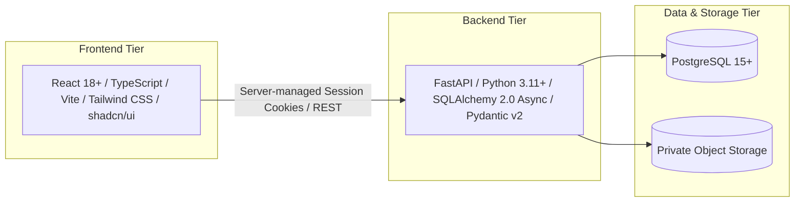

# ExcelR Track360

> **Track Every Student. Every Assignment. Every Milestone.**

**ExcelR Track360** is an enterprise-grade, internal Student Lifecycle & Operations Management Platform. It replaces fragmented spreadsheets and ad-hoc email communications with a unified, auditable, and role-governed operational system of record.

The platform orchestrates the complete student journey: candidate profiling, cohort onboarding, multi-attempt assignment submissions and rubric reviews, collaborative group project allocations, internship milestone tracking, tamper-evident certificate issuance, and executive operational reporting.

---

## 1. System Purpose & Core Capabilities

- **Single Golden Profile:** Maintains one authoritative record per candidate from initial enrollment through post-completion alumni status, preventing profile duplication across batches.
- **Authoritative Review Cycles:** Decouples assignment submission from approval. Enforces server-authoritative UTC timestamps, file-type validations, multi-round resubmissions, and immutable attempt versioning.
- **Strict Prerequisite Gating:** Enforces that candidates complete 100% of mandatory curriculum assignments before unlocking project allocations.
- **Dynamic Collaborative Projects:** Facilitates configurable group formation (custom team sizes), milestone reviews, group deliverable submissions, and progression tracking capped at a maximum of three (3) sequential projects.
- **Intelligent Group Readiness:** Evaluates whether all required group members have completed deliverables and submitted individual advancement requests, providing clear administrative exception workflows for lagging or inactive candidates.
- **Decoupled Internship Tracking:** Separates real-world corporate calendar internship dates from accredited certificate durations (1 project = 3 months, 2 projects = 6 months, 3 projects = 9 months).
- **Tamper-Evident Credentialing:** Enforces a two-tier approval workflow, cryptographically unique certificate serial IDs, dynamic QR codes, and a public, tokenized verification portal requiring no login.
- **Comprehensive Auditability:** Immutably records every administrative waiver, status transition, score adjustment, and data export operation.

---

## 2. Proposed Architecture & Technology Stack

The platform is designed as a **Modular Monolith** with clean domain boundaries:



### Technology Stack Specifications
- **Frontend:** React, TypeScript, Vite, Tailwind CSS, shadcn/ui component primitives, React Router v6, TanStack Query v5, React Hook Form, Zod.
- **Backend:** Python 3.11+, FastAPI, SQLAlchemy 2.0 (Async/Declarative), Alembic migrations, Pydantic v2 schemas.
- **Database:** PostgreSQL 15+.
- **Testing:** Pytest, HTTPX, Vitest, React Testing Library.
- **Infrastructure:** Docker, Docker Compose, Git.
- **Security:** Server-side managed sessions (`HttpOnly`, `SameSite=Lax`, encrypted cookies), server-side RBAC on every API endpoint, private asset storage via temporary streaming tokens.

---

## 3. Documentation Structure

All system design, architectural models, and specifications reside under [`docs/`](file:///c:/Users/ExcelR/OneDrive/Desktop/ExcelR%20Track360/docs/):

```
docs/
├── requirements/
│   ├── BRD.md                          # Business Requirements Document
│   ├── SRS.md                          # Software Requirements Specification
│   ├── USER_ROLES_AND_PERMISSIONS.md   # Role-Permission Matrix across 9 roles
│   ├── BUSINESS_RULES.md               # Explicit logic & exception rules
│   ├── WORKFLOW_SPECIFICATION.md       # Step-by-step lifecycle workflows & states
│   ├── PAGE_INVENTORY.md               # Catalog of 30+ admin & student pages
│   ├── ACCEPTANCE_CRITERIA.md          # Given-When-Then testable specifications
│   └── OPEN_BUSINESS_QUESTIONS.md      # Unresolved decisions & stakeholder options
├── architecture/                       # System architecture & component design (Phase 2)
├── database/                           # Relational schemas & Alembic migrations (Phase 3)
├── workflows/                          # State machines & sequence flows
└── testing/                            # Quality assurance & automated test plans
```

---

## 4. Planned 18-Phase Development Roadmap

Track360 is built systematically across 18 development phases to guarantee production rigor and zero unverified assumptions:

| Phase | Phase Name | Focus & Primary Deliverables | Status |
| :---: | :--- | :--- | :---: |
| **01** | **Requirements & Business Analysis** | BRD, SRS, Role Matrix, Business Rules, Workflows, Page Inventory, Acceptance Criteria, Open Questions. | **COMPLETE** |
| **02** | **System Architecture & Technical Design** | Component boundaries, API contracts, session security design, error schemas, state machine models. | *Up Next* |
| **03** | **Database Schema Design & Data Modeling** | PostgreSQL DDL, SQLAlchemy 2.0 models, Alembic migrations, indexing strategy, audit schemas. | Planned |
| **04** | **Project Scaffolding & DevOps Foundation** | Docker Compose setup, FastAPI backend skeleton, Vite frontend workspace, linting & CI scripts. | Planned |
| **05** | **Authentication, Sessions & RBAC Foundation** | Cookie session management, password hashing, role guard middlewares, authentication endpoints. | Planned |
| **06** | **Candidate Management Module** | Authoritative profiles, CSV batch import with dry-run validation, candidate search & filters. | Planned |
| **07** | **Assignment Authoring & Allocation Engine** | Template editor, rubric parameters, batch & individual student allocations, deadline rules. | Planned |
| **08** | **Student Submission & Private Storage** | Student submission dropzone, private file storage streaming, server UTC timestamping, lateness flags. | Planned |
| **09** | **Assignment Review & Resubmission Engine** | Reviewer queues, rubric scoring workspace, correction requests, immutable attempt history. | Planned |
| **10** | **Milestone Progression & Project Eligibility Gate** | 100% assignment passing verification engine, eligibility badges, exception waiver workflows. | Planned |
| **11** | **Project Catalog & Dynamic Group Builder** | Project specs library, drag-and-drop group builder, configurable sizing, duplicate check. | Planned |
| **12** | **Group Deliverable Submission & Evaluation** | Shared group deliverables repository, team evaluation workspace, corrections cycle. | Planned |
| **13** | **Group Readiness & Multi-Project Progression** | Readiness engine, blocked member alerts, inactive member removal, split workflows, max 3 projects cap. | Planned |
| **14** | **Internship Tracking & Duration Policy Mapping** | Calendar date tracking, duration multiplier policy (1=3mo, 2=6mo, 3=9mo), milestone completion. | Planned |
| **15** | **Certificate Approvals & Public Verification** | Two-tier approval gate, unique serial generation, PDF & QR engine, public verification portal. | Planned |
| **16** | **Notifications & Communication Queue** | In-app alerts, background SMTP email dispatch queue, retry with exponential backoff. | Planned |
| **17** | **Operational Reporting & Audit Log Explorer** | Executive cockpits, SLA metrics, immutable audit explorer, role-governed CSV/Excel exports. | Planned |
| **18** | **End-to-End Hardening, QA & Production Readiness** | Integration test suite, security penetration audit, performance load testing, operational runbooks. | Planned |

---

## 5. Current Development Phase

- **Active Phase:** Phase 1 – Requirements & Business Analysis
- **Milestone Status:** **100% Complete.** All 8 required Phase 1 specifications have been authored, peer-referenced, and validated under `docs/requirements/`.

---

## 6. Instructions for Progressing to Phase 2

To proceed to **Phase 2: System Architecture & Technical Design**, run the following operational steps:
1. Review the open business decisions documented in [`OPEN_BUSINESS_QUESTIONS.md`](file:///c:/Users/ExcelR/OneDrive/Desktop/ExcelR%20Track360/docs/requirements/OPEN_BUSINESS_QUESTIONS.md) with organizational stakeholders.
2. Ensure no uncommitted working files remain in the repository.
3. Prompt the assistant:
   > *"Phase 1 is verified and complete. Proceed to Phase 2: System Architecture & Technical Design."*
