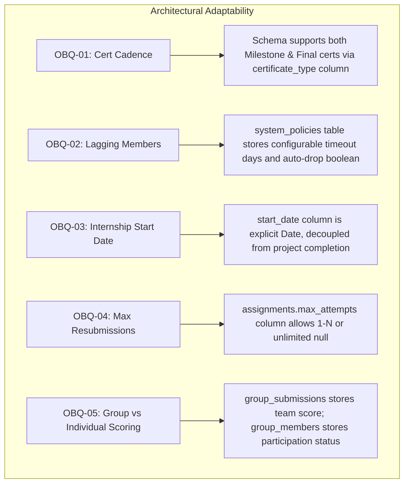

# Architectural Decisions & Stakeholder Alignment Record (Phase 2)
## Project: ExcelR Track360
### Student Lifecycle & Operations Management Platform
**Document Reference:** ADR-TRK360-V1.0  
**Phase:** Phase 2 – System Architecture & Database Design  
**Status:** Approved for Implementation Planning  

---

## 1. Architectural Decision Records (ADRs)

### ADR-01: Architectural Pattern — Modular Monolith over Microservices
- **Context:** The platform manages high-integrity educational workflows across several related business domains (candidates, assignments, collaborative projects, internships, certificates). Team operational overhead and deployment complexity must be minimized.
- **Decision:** Build Track360 as a **Modular Monolith** using FastAPI and PostgreSQL, enforcing strict package-level domain isolation under `app/modules/`.
- **Alternatives Considered:**
  - *Microservices Architecture:* Rejected due to severe operational complexity (distributed transactions, multi-repo CI/CD, network latency, eventual consistency challenges for student records, Kubernetes overhead).
  - *Unstructured Monolith:* Rejected due to high risk of cross-table spaghetti joins and untrackable side effects.
- **Consequences:**
  - *Positive:* Single unified deployment, instant ACID transactions, simple debugging, high developer velocity, and zero network latency between modules.
  - *Negative:* Requires disciplined code reviews to prevent circular domain imports.

---

### ADR-02: Authentication — Server-Side Managed Sessions over Stateless JWTs
- **Context:** Administrative staff manage high-stakes decisions (grading overrides, credential approvals). Compromised credentials must be instantly revocable. Students should not be vulnerable to XSS token theft.
- **Decision:** Authenticate via **Server-Managed Sessions** stored in PostgreSQL and transmitted via encrypted, `HttpOnly`, `SameSite=Lax`, `Secure` cookies.
- **Alternatives Considered:**
  - *Stateless JWTs in LocalStorage:* Rejected due to extreme vulnerability to XSS attacks, inability to revoke stolen tokens before expiration, and token size bloat.
  - *OAuth2 / OIDC External Provider:* Deferred to future enterprise phases; internal session store is optimal for MVP and standalone operations.
- **Consequences:**
  - *Positive:* 100% instant session revocation on logout or account lock, zero client-side token exposure to JavaScript, and simple session expiry tracking.
  - *Negative:* Database lookup per authenticated request (mitigated via index on `user_sessions` and connection pooling).

---

### ADR-03: Primary Key Strategy — UUIDv7 over Auto-Increment Integers or UUIDv4
- **Context:** Primary keys must support distributed generation, prevent competitive business intelligence (e.g. integer guessing of candidate count), and preserve high database write performance.
- **Decision:** Use **UUIDv7** (RFC 9562) as the standard primary key type across all database tables.
- **Alternatives Considered:**
  - *BIGSERIAL (Auto-Incrementing Integers):* Rejected because sequential IDs expose total candidate counts and are vulnerable to enumeration attacks on public endpoints (e.g. `/api/v1/candidates/1042`).
  - *UUIDv4 (Random UUIDs):* Rejected because purely random UUIDs cause severe B-Tree index page splitting and high disk I/O under large datasets.
- **Consequences:**
  - *Positive:* UUIDv7 embeds a millisecond-precision UTC timestamp in the leading 48 bits, providing natural chronological sorting and preserving B-Tree index clustering while remaining completely unguessable.

---

### ADR-04: Data Layer — SQLAlchemy 2.0 Async ORM with Declarative Models
- **Context:** The backend requires high concurrent throughput for review queues, CSV validation, and file streaming.
- **Decision:** Utilize **SQLAlchemy 2.0 async ORM** backed by `asyncpg`.
- **Consequences:**
  - *Positive:* Non-blocking asynchronous I/O, modern type-annotated declarative models, and full compatibility with FastAPI async route handlers.
  - *Negative:* Requires async session management and strict boundary handling to prevent lazy-loading attribute errors outside transaction contexts.

---

### ADR-05: Private Asset Storage Abstraction
- **Context:** Student submissions, reviewer attachments, and generated certificates must be securely quarantined in private storage, while supporting both local developer setups and enterprise cloud deployments.
- **Decision:** Build an abstract `StorageService` interface with `LocalStorageBackend` (local filesystem) and `S3StorageBackend` (S3/MinIO compatible object store).
- **Consequences:**
  - *Positive:* Developers can run the platform locally with zero cloud dependencies; production environments can switch to S3 via a single environment variable (`STORAGE_BACKEND=s3`).
  - *Negative:* Requires custom streaming endpoints for file downloads.

---

## 2. Schema Accommodations for Open Business Questions

In adherence to Mandatory Development Rules #6 and #13 (*"Do not invent answers to unresolved business questions; ensure architecture supports future changes"*), the schema and architecture are intentionally designed to accommodate both options for all 8 open questions from Phase 1 without requiring breaking database migrations:

| Question ID | Unresolved Decision | How Schema & Architecture Accommodate Both Options |
| :---: | :--- | :--- |
| **OBQ-01** | **Certificate Cadence:** Milestone-based vs Final Exit only. | The `certificates` table includes `certificate_type` (`MILESTONE` vs `FINAL_COMPREHENSIVE`) and `milestone_level` (1, 2, 3 or null). If the business chooses Option A, milestone rows are created; if Option B, a single comprehensive row is created. Zero schema change required. |
| **OBQ-02** | **Lagging Member Protocol:** Automated timeout vs Manual coordinator intervention. | The group readiness service queries the `system_policies` table for `group_readiness_timeout_days` and `auto_drop_lagging_members_enabled`. Either policy is executed purely via service configuration. |
| **OBQ-03** | **Internship Start Date:** Automated from Project 1 vs Manual coordinator entry. | The `internship_records.start_date` column is an explicit date field. If automated, the service sets it to `project_groups.created_at`; if manual, the coordinator updates it via `PATCH /internships/{id}`. |
| **OBQ-04** | **Resubmission Attempt Limits:** Unlimited vs Capped at 3. | The `assignments.max_attempts` column supports any integer limit (e.g. 3) or `NULL` (unlimited). Can be adjusted globally or per assignment. |
| **OBQ-05** | **Group Grading Model:** Uniform team grade vs Individual member scoring. | `group_submissions.score` stores the shared team deliverable score, while individual student progress is tracked via `project_completions`. If a member is penalized, coordinator sets their participation status to `WITHDRAWN` or `REMOVED`. |
| **OBQ-06** | **4th Project Extension:** Allowed criteria and authorization. | Handled via service authorization: Attempting a 4th project check passes only if an authorized `AuditLog` exception override is provided by `ROLE_SUPER_ADMIN`. |
| **OBQ-07** | **Revocation Display Text:** Generic vs Detailed public notice. | The public verification endpoint reads `certificates.status`. If `REVOKED`, it displays a neutral public message, while `certificate_revocations.detailed_reason` is restricted to internal staff. |
| **OBQ-08** | **Alumni Access Duration:** Indefinite vs 1-Year expiration. | The candidate `lifecycle_status` column includes `ALUMNI`. Scheduled cron jobs can query candidate completion date and policy duration to transition accounts without altering schema. |

---

## 3. Decisions Requiring Stakeholder Confirmation Before Phase 3

Before writing the initial Alembic migration scripts in Phase 3, the engineering team requests formal stakeholder confirmation on:
1. **Default Passing Threshold:** Confirming standard default is 60.00% across all curriculum modules.
2. **Standard Group Sizing Bounds:** Confirming standard defaults: Min = 2, Target = 4, Max = 5.
3. **Primary S3 Storage Provider:** Confirming target cloud environment (AWS S3, MinIO, or Cloudflare R2) for production staging.
