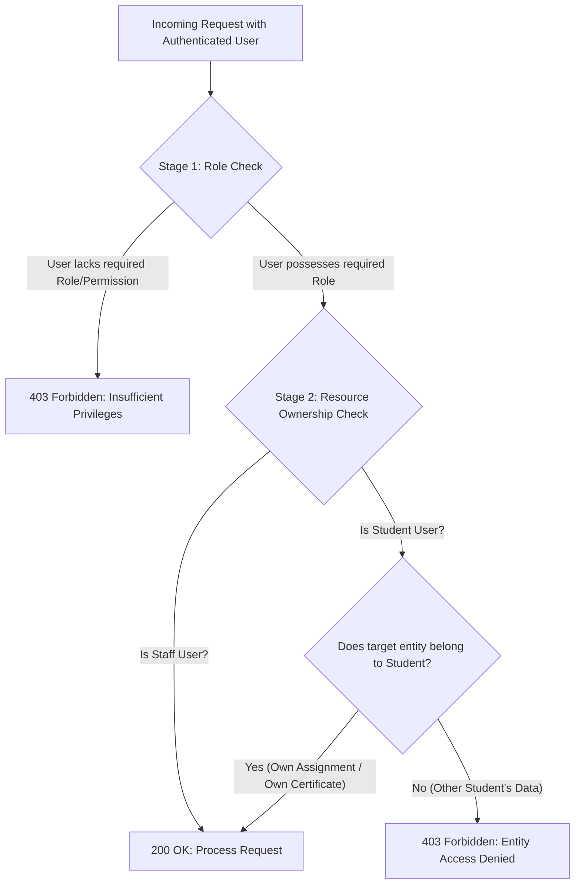

# Security Architecture & Data Protection Specification
## Project: ExcelR Track360
### Student Lifecycle & Operations Management Platform
**Document Reference:** SEC-TRK360-V1.0  
**Phase:** Phase 2 – System Architecture & Database Design  
**Status:** Approved for Implementation Planning  

---

## 1. Security Architecture Principles & Zero-Trust Posture

ExcelR Track360 processes sensitive academic evaluations, personal contact information, collaborative group deliverables, and authoritative career credentials. The security architecture enforces the following principles:

1. **Zero Client Trust:** All authorization, state transition checks, timestamp generations, and data sanitizations occur authoritatively on the backend.
2. **Defense in Depth:** Security controls are implemented at multiple layers: network perimeter, reverse proxy headers, application session middleware, service-level RBAC guards, database constraints, and encrypted backups.
3. **Least Privilege & Role Segregation:** Users are assigned only the minimum necessary permissions. Approval chains (such as certificate sign-off) require strict Separation of Duties (SoD).
4. **Permanent Auditability:** Any administrative bypass, score modification, or prerequisite waiver produces an immutable, tamper-evident audit record.

---

## 2. Authentication & Session Lifecycle Management

Authentication is managed via **Server-Side Managed Sessions** rather than stateless JWTs. This architecture eliminates the severe security drawbacks of client-stored tokens (e.g., inability to instantly revoke compromised tokens).

```mermaid
sequenceDiagram
    autonumber
    actor User as User / Client Browser
    participant Gateway as Reverse Proxy / Nginx
    participant Auth as FastAPI Auth Middleware
    participant DB as PostgreSQL Session Store

    User->>Gateway: POST /api/v1/auth/login (email, password)
    Gateway->>Auth: Validates payload, passes request
    Auth->>DB: Verifies user & checks account lockout status
    Auth->>Auth: Verifies password via Argon2id
    Auth->>DB: Creates user_sessions record (UUIDv7, session_token_hash, expires_at)
    Auth-->>Gateway: HTTP 200 OK + Set-Cookie: track360_session=TOKEN; HttpOnly; Secure; SameSite=Lax
    Gateway-->>User: Session Established

    Note over User,DB: Authenticated Request Lifecycle
    User->>Gateway: GET /api/v1/candidates (Cookie: track360_session=TOKEN)
    Gateway->>Auth: Forwards request
    Auth->>DB: SELECT * FROM user_sessions WHERE session_token_hash = HASH(TOKEN) AND expires_at > NOW() AND is_revoked = FALSE
    Auth->>DB: UPDATE user_sessions SET last_activity_at = NOW()
    Auth->>Auth: Injects AuthenticatedUser into request context
    Auth-->>User: 200 OK Response

    Note over User,DB: Session Revocation / Logout
    User->>Auth: POST /api/v1/auth/logout
    Auth->>DB: UPDATE user_sessions SET is_revoked = TRUE WHERE id = CURRENT_SESSION_ID
    Auth-->>User: HTTP 200 OK + Clear-Cookie: track360_session
```

### 2.1 Cookie Security Directives
- **`HttpOnly`:** Enforced on all session cookies to prevent document JavaScript access, mitigating Cross-Site Scripting (XSS) session theft.
- **`Secure`:** Transmitted exclusively over encrypted HTTPS connections in staging and production environments.
- **`SameSite=Lax`:** Default setting to prevent Cross-Site Request Forgery (CSRF) across top-level cross-site navigations while permitting normal user navigation.
- **`Path=/api`:** Restricts cookie transmission to backend API requests.

### 2.2 Session Lifetime Policies
- **Idle Timeout:** 8 hours (28,800 seconds). If no request is received for 8 hours, the session expires.
- **Absolute Hard Timeout:** 24 hours (86,400 seconds) for administrative staff; 14 days for students. Regardless of activity, sessions must be re-authenticated upon reaching the hard limit.
- **Concurrent Session Policy:** Users can log in from up to 3 concurrent devices. Logging in from a 4th device invalidates the oldest active session.

---

## 3. Cryptographic Standards & Password Protection

1. **Password Hashing:**
   - **Algorithm:** `Argon2id` (winner of the Password Hashing Competition, memory-hard against GPU/ASIC cracking).
   - **Parameters:**
     - Time cost ($t$): 3 iterations
     - Memory cost ($m$): 64 MB ($65,536\text{ KiB}$)
     - Parallelism ($p$): 4 threads
   - Plaintext passwords or weak MD5/SHA256 hashes are strictly prohibited.
2. **Brute Force Lockout Policy:**
   - 5 consecutive failed login attempts on an account within a 15-minute sliding window triggers an automated account lockout for 15 minutes (`locked_until = NOW() + INTERVAL '15 minutes'`).
   - Failed attempts and lockout events are recorded in the security audit log.

---

## 4. Role-Based & Object-Level Authorization (RBAC & ABAC)

Authorization is verified in two sequential stages:



### 4.1 Granular Role Boundaries
- **Server Enforcement:** Endpoint declarations use explicit dependency injection:
  ```python
  @router.post("/certificates/{id}/approve")
  async def approve_certificate(
      id: UUID,
      user: AuthenticatedUser = Depends(require_permission(Permission.CERT_APPROVE))
  ):
      ...
  ```
- **Separation of Duties (SoD):** A coordinator who submits a certificate issuance request cannot act as the `approver_id` for that certificate. The backend verifies:
  $$\text{approver\_id} \ne \text{requester\_id}$$

---

## 5. Candidate Data Privacy & PII Protection

To protect student personally identifiable information (PII):
1. **Field-Level Data Redaction:**
   - When project teammates view their group roster in the student portal, the API returns only teammate `first_name`, `last_name`, and public readiness status. Contact information (phone, email, academic qualification) is stripped from group view schemas.
2. **Data Export Restrictions:**
   - Bulk exports of candidate registries (CSV/Excel) are restricted exclusively to `ROLE_SUPER_ADMIN` and `ROLE_OPS_ADMIN`. Every export operation logs the filtering criteria, target row count, and actor IP address in `audit_logs`.
3. **Zero Real PII in Development:**
   - Test fixtures, local seed scripts (`seed_dev_data.py`), and staging environments must exclusively generate synthetic Faker records.

---

## 6. CSRF & Request Forgery Defenses

1. **Custom Request Header Requirement:**
   - All state-changing mutating requests (`POST`, `PUT`, `PATCH`, `DELETE`) require the custom request header:
     `X-Requested-With: XMLHttpRequest` or `X-CSRF-Token: <token>`.
   - Modern browsers prevent cross-origin scripts from attaching custom headers without an explicit CORS preflight approval (`OPTIONS`).
2. **CORS Restrictions:**
   - Allowed origins are explicitly whitelisted in environment settings (`ALLOWED_CORS_ORIGINS`). Wildcard origins (`*`) combined with credentialed cookies (`allow_credentials=True`) are strictly blocked.

---

## 7. Rate Limiting Strategy

Rate limits are enforced at the API gateway layer using a sliding window counter:

| Endpoint Category | Rate Limit Window | Max Requests | Violation Action |
| :--- | :--- | :--- | :--- |
| **Authentication Endpoints** (`/api/v1/auth/login`, `/forgot-password`) | 15 Minutes | 5 attempts per IP / Account | HTTP 429 Too Many Requests |
| **Public Verification** (`/api/v1/verify/*`) | 1 Minute | 60 requests per IP | HTTP 429 + Cooldown banner |
| **File Upload Endpoints** (`/api/v1/allocations/*/submit`) | 1 Hour | 15 uploads per User | HTTP 429 |
| **Standard Administrative Read Endpoints** | 1 Minute | 300 requests per User | HTTP 429 |

---

## 8. Private Asset File Security & Quarantine

Uploaded student files (.pdf, .zip, .ipynb) present potential attack vectors (malware, zip bombs, malicious scripts):

1. **Quarantine & File Validation:**
   - Client-supplied MIME types and file extensions are treated as untrusted.
   - Upon upload, the backend inspects the **magic bytes** (file signature) to verify authentic file formats.
   - Executable extensions (`.exe`, `.sh`, `.bat`, `.cmd`, `.js`, `.vbs`) are rejected immediately with HTTP 422.
2. **File Decompression Bombs:**
   - Zip archives are scanned for compression ratio. Archives with a compression ratio $> 100:1$ or uncompressed size $> 100\text{ MB}$ are rejected.
3. **Non-Guessable Storage Keys:**
   - Files are stored using cryptographic UUID paths:  
     `storage_private/submissions/2026/0192a83f-42e1-7000-8000-000000000042.dat`
   - Files are never saved using their original user-provided filename on disk.
4. **Tokenized Private Streaming:**
   - Files are served only through the authenticated route `/api/v1/files/{id}/stream`. The endpoint verifies that the requester has academic jurisdiction over the student's submission before streaming bytes.

---

## 9. Immutable Audit Logging Strategy

The `audit_logs` table serves as the authoritative legal and operational audit trail for Track360:

1. **Append-Only Immutability:**
   - Database user permissions for application connections grant `SELECT` and `INSERT` on `audit_logs`. `UPDATE` and `DELETE` privileges are explicitly revoked.
2. **Captured Audit Payload:**
   - `actor_user_id`: UUID of acting staff member (or null for automated system tasks).
   - `actor_ip_address`: Remote client IP address extracted from reverse proxy headers.
   - `actor_user_agent`: Browser or API client identifier.
   - `action_type`: E.g., `PREREQUISITE_WAIVER`, `GROUP_READINESS_BYPASS`, `SCORE_OVERRIDE`, `CERTIFICATE_REVOCATION`.
   - `pre_state` & `post_state`: Complete JSONB snapshots of the entity before and after modification.
   - `justification`: Mandatory human explanation ($\ge 20$ characters) for exception overrides.

---

## 10. Secrets Management & Disaster Recovery

1. **Zero Hardcoded Secrets:**
   - All credentials (database passwords, session secret keys, SMTP passwords) are injected via container environment variables or Docker Secrets.
2. **Backup & Recovery Objectives:**
   - **RPO (Recovery Point Objective):** $< 1\text{ hour}$ via continuous PostgreSQL Write-Ahead Log (WAL) archiving.
   - **RTO (Recovery Time Objective):** $< 4\text{ hours}$ to spin up a fully restored instance from automated daily full snapshots.
   - Backup snapshots are encrypted with AES-256 before transmission to offsite storage.
