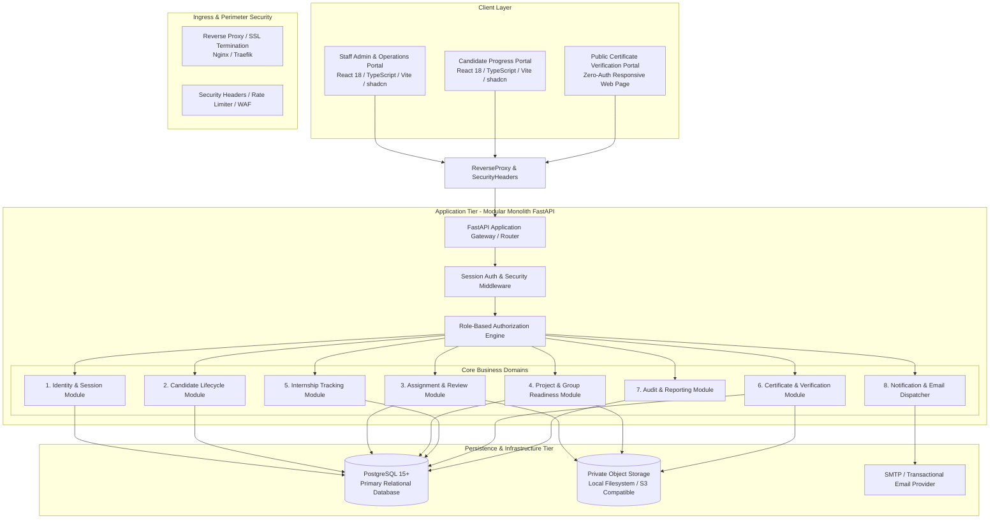
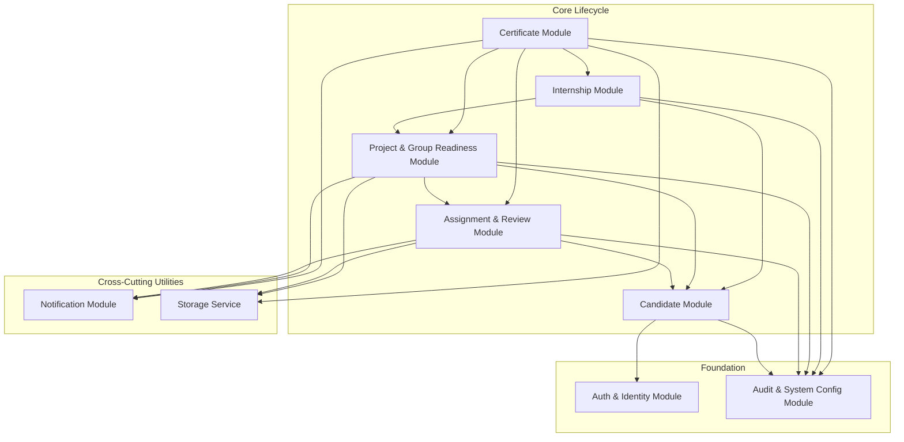
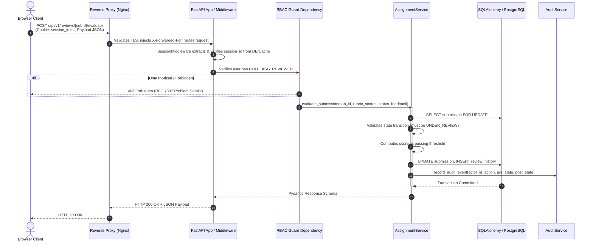

# System Architecture Specification
## Project: ExcelR Track360
### Student Lifecycle & Operations Management Platform
**Document Reference:** ARC-TRK360-V1.0  
**Phase:** Phase 2 – System Architecture & Database Design  
**Status:** Approved for Implementation Planning  

---

## 1. Architectural Overview & Context

**ExcelR Track360** is architected as an enterprise-grade **Modular Monolith**. This pattern combines the operational simplicity, transactional consistency, and developer velocity of a unified monolithic codebase with the strict domain boundaries, high cohesion, and loose coupling of microservices.



---

## 2. Component Responsibilities & System Boundaries

### 2.1 Client Tier (Frontend SPA)
- **Framework & Runtime:** React 18+ with TypeScript, bundled via Vite.
- **UI Architecture:** Built on Tailwind CSS and shadcn/ui accessible component primitives (Radix UI engine).
- **State Management:**
  - *Server State:* Managed exclusively via TanStack Query (React Query v5) for automated caching, background invalidation, and optimistic updates.
  - *Client State:* Lightweight React Context for active user session, theme, and navigation state.
- **Form Handling & Validation:** React Hook Form integrated with Zod schemas matching backend Pydantic contracts.
- **Dual Portal Layouts:**
  - *Staff Operations Portal (`/admin/*`):* High information density, advanced tabular filters, multi-step review workspaces, and batch CSV processing.
  - *Student Portal (`/student/*`):* Visual progress trackers, assignment upload dropzones, team readiness status boards, and credential repositories.
  - *Public Verification (`/verify/:serial`):* Lightweight, zero-authentication public route displaying authentic certificate metadata.

### 2.2 Edge & Security Perimeter
- **Reverse Proxy:** Terminating TLS 1.3, setting HSTS, enforcing Content Security Policy (CSP), anti-clickjacking (`X-Frame-Options: DENY`), and MIME-type sniffing prevention.
- **Session Cookie Ingress:** Handles incoming `HttpOnly`, `SameSite=Lax`, `Secure` session cookies, terminating raw client access and passing sanitized requests to the backend.
- **IP-Level Rate Limiting:** Enforces connection-level and path-level throttles on authentication and export endpoints.

### 2.3 Application Core (FastAPI Backend)
- **Runtime:** Python 3.11+ running with `uvicorn` (ASGI).
- **Design Pattern:** Domain-Driven Design (DDD) layered modular architecture:
  1. *Router / Controller Layer:* HTTP method bindings, request deserialization, Pydantic schema validation, and dependency injection.
  2. *Security / Dependency Layer:* Session validation, user extraction, and declarative role-based permission checks.
  3. *Service Layer:* Pure business logic orchestration, domain state machine transitions, and rule enforcement.
  4. *Repository / Unit of Work Layer:* Encapsulated SQLAlchemy 2.0 async database queries and atomic transaction scopes.
- **Background Tasks:** Non-blocking asynchronous task execution for sending transactional emails, generating certificate PDFs, and processing bulk CSV dry-runs.

### 2.4 Data Tier (PostgreSQL)
- **Engine:** PostgreSQL 15+ relational database.
- **Integrity Enforcement:** Strict database-level foreign key constraints, cascading rules, unique indexes, and check constraints (`CHECK`).
- **Concurrency Management:** PostgreSQL row-level locking (`SELECT ... FOR UPDATE`) during critical state transitions (e.g., group progression requests and certificate approvals) to eliminate race conditions.
- **Schema Migrations:** Managed exclusively through version-controlled, bidirectional Alembic migration scripts.

### 2.5 Private Object Storage Tier
- **Storage Policy:** Student submission archives, evaluation reference files, and generated certificate PDFs are **never** stored in public web directories.
- **Storage Abstraction:** A unified `StorageService` interface:
  - *Development & Local Testing:* Local filesystem storage root under an isolated, non-served path.
  - *Production / Staging:* S3-compatible private object store (e.g., AWS S3, MinIO, Cloudflare R2).
- **Access Protocol:** File retrieval is mediated strictly through authenticated backend streaming routes or short-lived, cryptographically signed access tokens.

---

## 3. Module Dependencies & Domain Boundaries

To prevent monolithic spaghetti, dependencies between domains follow a strict directional hierarchy. Cross-module database joins are minimized; modules communicate via explicit Service APIs or shared database identifiers.



### Domain Boundary Rules:
1. **Zero Circular Imports:** Upstream modules (e.g., `Certificate`) may call downstream services (e.g., `AssignmentService.verify_all_passed(candidate_id)`), but downstream modules never import upstream modules.
2. **Transactional Integrity:** State changes spanning multiple entities within a single domain execute in an atomic transaction. Multi-domain orchestrations (e.g., approving a final project which creates internship eligibility) are driven by explicit service calls within an orchestrated transaction.
3. **Audit Trail Invariance:** Any service operation that modifies candidate status, waives a prerequisite, changes a score, or revokes a credential must record an `AuditLog` entry before committing the transaction.

---

## 4. End-to-End Request & Response Lifecycle

The typical lifecycle of an authenticated mutating API request (e.g., a reviewer submitting an assignment evaluation) proceeds as follows:



---

## 5. Error-Handling Architecture

The platform adheres to **RFC 7807 (Problem Details for HTTP APIs)** for all error responses. This guarantees that client applications receive uniform, machine-readable, and human-actionable error envelopes.

### 5.1 Standard Problem Details Schema
```json
{
  "type": "https://errors.track360.excelr.com/errors/PREREQUISITE_FAILED",
  "title": "Prerequisite Assignment Incomplete",
  "status": 400,
  "detail": "Candidate CAN-2026-0042 cannot be allocated to Project 1 because mandatory assignment ASG-003 is in 'CORRECTIONS_REQUESTED' status.",
  "instance": "/api/v1/projects/allocations",
  "code": "ERR_PREREQUISITE_INCOMPLETE",
  "timestamp": "2026-10-24T12:45:00Z",
  "invalid_params": [
    {
      "name": "candidate_id",
      "reason": "Unapproved mandatory assignment ASG-003"
    }
  ]
}
```

### 5.2 Exception Hierarchy in Backend
```
AppException (Base Application Exception)
├── AuthenticationError (401 Unauthorized)
│   ├── SessionExpiredError
│   └── InvalidCredentialsError
├── AuthorizationError (403 Forbidden)
│   ├── InsufficientRoleError
│   └── TenantAccessViolationError
├── ResourceNotFoundError (404 Not Found)
├── ConflictError (409 Conflict)
│   ├── DuplicateCandidateError
│   └── DuplicateCertificateError
├── BusinessRuleViolationError (400 / 422 Bad Request)
│   ├── PrerequisiteNotMetError
│   ├── GroupReadinessBlockedError
│   ├── MaxProjectsExceededError
│   └── ResubmissionAttemptLimitExceededError
└── StorageError (500 Internal Storage Error)
```

---

## 6. Security Boundaries & Zero-Trust Enforcement

1. **Authentication Boundary:**
   - Publicly accessible routes: `/api/v1/auth/login`, `/api/v1/auth/forgot-password`, `/api/v1/auth/reset-password`, and `/api/v1/certificates/verify/:serial`.
   - All other routes require an active server-side session verified via cryptographic session IDs.
2. **Authorization Boundary:**
   - Declarative role injection at FastAPI endpoint definitions: `Depends(require_role([Role.OPS_ADMIN, Role.SUPER_ADMIN]))`.
   - Object-level ownership validation: Students can only view their own candidate profile, allocations, and certificates.
3. **File Isolation Boundary:**
   - Uploaded files are quarantined and verified for MIME magic bytes and extension whitelist before permanent storage.
   - Files are stored with UUID-based keys in private storage with zero direct web server mapping.
4. **Audit Immutability Boundary:**
   - The `audit_logs` table is append-only. No UPDATE or DELETE operations are exposed via any application endpoint or repository method.
