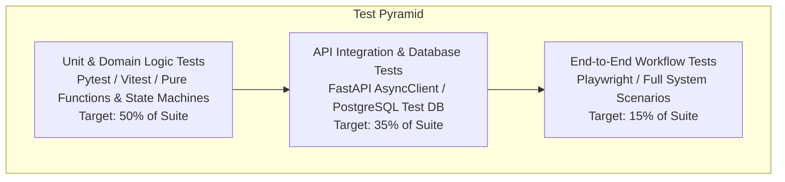

# Testing Strategy & Quality Assurance Architecture
## Project: ExcelR Track360
### Student Lifecycle & Operations Management Platform
**Document Reference:** TST-TRK360-V1.0  
**Phase:** Phase 2 – System Architecture & Database Design  
**Status:** Approved for Implementation Planning  

---

## 1. Testing Philosophy & Quality Gates

ExcelR Track360 enforces an uncompromising automated testing strategy governed by Mandatory Development Rules #5, #6, and #7 (*"Never claim a feature works unless verified; never suppress test failures; never create fake API responses to simulate success"*).



### Quality Gate Metrics
1. **Code Coverage:** Minimum **85% branch coverage** across all domain service layers, business rule evaluators, and state machines.
2. **Deterministic Execution:** 0% tolerance for flaky tests. Tests must run independently with zero cross-test state leakage.
3. **Database Isolation:** Every database test executes within an isolated transaction that rolls back automatically upon completion (`SAVEPOINT` / nested transaction fixtures).
4. **CI Enforcement:** Merging code into `main` requires 100% passing test suites across frontend lint/unit, backend pytest, and Alembic migration bidirectional checks.

---

## 2. Backend Testing Architecture (Python & Pytest)

### 2.1 Unit Tests (Pure Domain Logic)
- **Tooling:** `pytest`, `pytest-asyncio`, `pytest-mock`.
- **Target Areas:**
  - *State Machine Transitions:* Verifying valid and invalid lifecycle transitions for candidates, assignments, groups, and certificates.
  - *Readiness Calculation Logic:* Testing boolean group-readiness algorithms against varied group sizes (2, 3, 4, 5) and lagging member scenarios.
  - *Duration Mapping Engine:* Verifying accredited internship duration calculations across project milestones (1 project $\rightarrow$ 3 months, 2 $\rightarrow$ 6, 3 $\rightarrow$ 9).
  - *Scoring & Pass/Fail Evaluators:* Boundary testing scores around the passing threshold (e.g. 59.99 vs 60.00).

### 2.2 Database & Constraint Tests
- **Target Areas:**
  - *Unique Constraints:* Verifying that case-insensitive email duplicates, phone duplicates, and duplicate active certificates raise database integrity errors.
  - *Foreign Key Cascade Rules:* Verifying that deleting a user session cascades, while deleting a candidate with active enrollments is restricted (`ON DELETE RESTRICT`).
  - *Check Constraints:* Verifying that invalid lifecycle status values or out-of-range scores (e.g. 105/100) are rejected by PostgreSQL.

### 2.3 API Integration Tests
- **Tooling:** `httpx.AsyncClient` communicating with an in-memory or Docker-hosted PostgreSQL test database.
- **Fixture Matrix:** Pre-authenticated session fixtures for each of the 9 roles (`super_admin_client`, `ops_admin_client`, `candidate_coord_client`, `reviewer_client`, `project_coord_client`, `internship_coord_client`, `certificate_approver_client`, `read_only_client`, `student_client`).
- **Comprehensive RBAC Matrix Testing:** Automated parameterized test suite iterating through all API endpoints against all 9 client fixtures to verify that unauthorized roles receive HTTP 403 Forbidden.

---

## 3. Frontend Testing Architecture (Vitest & RTL)

### 3.1 Unit & Hook Tests
- **Tooling:** `vitest`, `@testing-library/react`, `@testing-library/react-hooks`.
- **Target Areas:**
  - *Zod Form Schemas:* Testing client-side validation rules (password complexity, email regex, required file types) before API dispatch.
  - *Custom Hooks:* Testing `useAuth`, `useDebounce`, and TanStack Query mutation hooks.
  - *Formatting Helpers:* Testing UTC-to-local timezone converters, duration formatters, and status badge color selectors.

### 3.2 Component & Integration Tests
- **Tooling:** `React Testing Library`, `user-event`, `Mock Service Worker (MSW)`.
- **Target Areas:**
  - *Reviewer Workspace Component:* Simulating a reviewer selecting rubric scores, entering feedback, and submitting an `APPROVED` or `CORRECTIONS_REQUESTED` action.
  - *Dry-Run CSV Modal Component:* Simulating CSV file upload, rendering the validation error matrix, and verifying that the confirm button is disabled when errors exist.
  - *Group Readiness Board:* Testing rendering of "Blocked" banners when a teammate has not requested progression.

---

## 4. End-to-End Core Workflow Test Scenarios

The test suite validates the five foundational student lifecycle journeys:

### Scenario 1: Candidate Ingestion & Batch Onboarding
```
[GIVEN] A CSV roster containing 10 valid candidate rows and 2 duplicate email rows.
[WHEN]  Candidate Coordinator invokes /api/v1/candidates/import/dry-run.
[THEN]  Status is 200 OK; report indicates 10 valid, 2 errored rows with row numbers.
[WHEN]  Coordinator fixes duplicates and submits /api/v1/candidates/import/commit.
[THEN]  10 candidates are created with lifecycle_status='ACTIVE'.
[AND]   Welcome emails are queued in email_queue.
```

### Scenario 2: Assignment Submission, Review & Attempt Versioning
```
[GIVEN] Candidate A has an active assignment allocation with due_date=T.
[WHEN]  Candidate A uploads submission at T+10m.
[THEN]  Submission attempt #1 is created with is_late=TRUE.
[AND]   Submission status is SUBMITTED; allocation completion status is INCOMPLETE.
[WHEN]  Reviewer evaluates attempt #1 with score=45 and status=CORRECTIONS_REQUESTED.
[THEN]  Candidate A is notified; attempt #1 is archived.
[WHEN]  Candidate A uploads revised code as attempt #2.
[THEN]  Attempt #2 is created; attempt #1 records remain permanently accessible.
[WHEN]  Reviewer evaluates attempt #2 with score=85 and status=APPROVED.
[THEN]  Allocation completion status transitions to PASSED_COMPLETED.
```

### Scenario 3: Prerequisite Gate & Collaborative Group Readiness
```
[GIVEN] Track requires 5 mandatory assignments. Candidate A has 4 approved, 1 incomplete.
[WHEN]  Project Coordinator attempts to allocate Candidate A to Project 1.
[THEN]  Request is rejected with HTTP 400 (ERR_PREREQUISITE_INCOMPLETE).
[WHEN]  Candidate A passes 5th assignment -> System flags project_eligible=TRUE.
[WHEN]  Coordinator forms Group 1 (Candidates A, B, C, D) for Project 1.
[WHEN]  Group deliverable is submitted and marked APPROVED by coordinator.
[AND]   Candidates A, B, and C click 'Request Progression', but Candidate D does not.
[THEN]  Group readiness status is BLOCKED_PENDING_MEMBERS.
[WHEN]  Coordinator removes Candidate D (inactive) with logged justification.
[THEN]  Group readiness recalculates immediately to READY_FOR_NEXT_PROJECT.
```

### Scenario 4: Internship Duration Decoupling & Certificate Issuance
```
[GIVEN] Candidate A has completed Project 1 (Milestone 1) and Project 2 (Milestone 2).
[WHEN]  Internship Coordinator reviews Candidate A's record.
[THEN]  Accredited duration is calculated as 6 Months (2 completed projects * 3 months).
[AND]   Coordinator inputs corporate calendar dates: 2026-01-01 to 2026-07-01.
[WHEN]  Candidate Coordinator requests certificate issuance for Milestone 2.
[THEN]  Certificate request enters queue with status PENDING_APPROVAL.
[WHEN]  Certificate Approver inspects milestone audit and clicks APPROVE.
[THEN]  Unique serial EXCELR-2026-[TRACK]-[HEX8] is generated.
[AND]   PDF artifact is rendered with embedded QR code.
[AND]   Public verification endpoint /verify/{serial} returns VALID status without login.
[WHEN]  Coordinator attempts to issue another Milestone 2 certificate for Candidate A.
[THEN]  Request is blocked with HTTP 409 Conflict (Duplicate active certificate).
```

### Scenario 5: Database Migration Verification
```
[WHEN]  Alembic executes 'upgrade head' on an empty PostgreSQL database.
[THEN]  All 37 tables, constraints, and indexes are created successfully.
[WHEN]  Alembic executes 'downgrade base'.
[THEN]  All tables are cleanly dropped with zero orphaned objects.
[WHEN]  Alembic executes 'upgrade head' again.
[THEN]  Schema is restored to exact target state.
```

---

## 5. Test Data Management & Fixture Isolation

1. **Synthetic Data Factories (`factory_boy`):**
   - Candidate, Batch, Submission, and Review fixtures are generated programmatically using synthetic Faker models.
   - Example:
     ```python
     class CandidateFactory(factory.alchemy.SQLAlchemyModelFactory):
         class Meta:
             model = Candidate
             sqlalchemy_session = db_session
         candidate_number = factory.Sequence(lambda n: f"CAN-2026-{n:05d}")
         email = factory.LazyAttribute(lambda o: f"{o.first_name.lower()}.{o.last_name.lower()}@synthetic.test")
         lifecycle_status = "ACTIVE"
     ```
2. **Zero Production PII in Development:**
   - Under no circumstances shall production candidate emails, phone numbers, or submission archives be copied to test or development environments.
