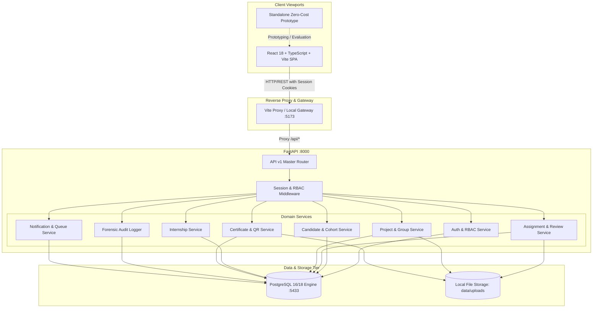
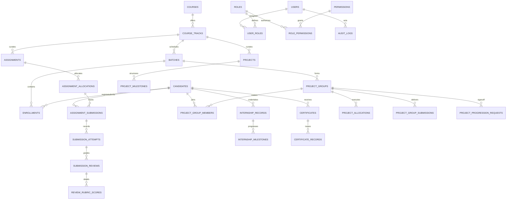

# System Architecture & Data Flow Specification
## Project: ExcelR Track360 (Student Lifecycle & Operations Management Platform)
**Document Reference:** ADF-TRK360-V1.0  
**Audit Date:** October 28, 2026  
**Architecture Pattern:** Modular Monolith with Domain-Driven Boundaries  

---

## 1. System Architecture Overview

ExcelR Track360 is engineered as an enterprise-grade **Modular Monolith** designed for operational efficiency, zero external paid dependencies, and high auditability. It decouples the presentation layer, REST API orchestration, domain business rules, and relational persistence.

---

## 2. Core Domain Boundaries & Entity Relationships

The relational data model consists of 37 tables organized into 6 core domains:

---

## 3. End-to-End Data Flows

### 3.1 Assignment Review & Prerequisite Completion Flow
1. **Student / Coordinator Action:** Student submits deliverable (or coordinator logs submission from email) $\rightarrow$ `POST /api/v1/assignments/submissions/{id}/attempts`.
2. **Timestamp Verification:** Backend captures authoritative server timestamp `utc_now()`, computes lateness delta against `due_date_utc`, and saves `SubmissionAttempt`.
3. **Reviewer Grading:** Assignment Evaluator evaluates rubric $\rightarrow$ `POST /api/v1/assignments/submissions/{id}/review`.
4. **Validation Enforcement:**
   - If `review_outcome == "APPROVED"`: Total rubric score must be $\ge$ `passing_score`.
   - If `review_outcome == "CORRECTIONS_REQUESTED"` (Redo): Qualitative feedback note must be non-empty and meaningful (minimum 10 non-whitespace characters).
5. **Gating Engine:** If status is `PASSED_COMPLETED`, system evaluates mandatory curriculum:
   - Query: `COUNT(mandatory_assignments_passed) == COUNT(total_mandatory_assignments)`.
   - If 100% complete: `candidate.project_eligible = True`, `candidate.assignment_completed_at_utc = utc_now()`.
   - Immutable audit event recorded: `candidate:project_eligible`.

### 3.2 15-Business-Day Project Queue & Allocation Flow
1. **Queue Ingestion:** When `candidate.project_eligible == True` and candidate is not currently allocated to an active group, candidate appears in `GET /api/v1/projects/queue`.
2. **SLA Calculation:** System computes business days between `assignment_completed_at_utc` and current UTC date (excluding Saturdays, Sundays, and organizational holidays).
   - If `business_days > 15`: `is_overdue_15_days = True`.
3. **Group Allocation:** Project Coordinator forms or selects group $\rightarrow$ `POST /api/v1/projects/groups/{id}/allocate`.
   - Enforces single active project constraint (BR-PRJ-04).
   - Enforces max 3 projects cap (BR-PRJ-02).
   - Enforces dynamic group sizing `min_size <= active_members <= max_size` (AC-PRJ-003).
4. **Dropped Workflow:** If project is dropped $\rightarrow$ `POST /api/v1/projects/allocations/{id}/drop`.
   - Mandatory coordinator reason required.
   - Allocation status updated to `DROPPED`; completion credit blocked.

### 3.3 Certificate Issuance & Public Verification Flow
1. **Eligibility Evaluation:** Evaluates 100% mandatory assignments + completed project count + NASSCOM clearance (for DA/BA/DS tracks).
2. **Stage 1 Coordinator Review:** Coordinator verifies documentation and submits recommendation $\rightarrow$ `POST /api/v1/certificates/{id}/stage1-review`.
3. **Stage 2 Director Sign-off:** Independent Director signs off (Segregation of Duties: reviewer $\neq$ approver) $\rightarrow$ `POST /api/v1/certificates/{id}/stage2-approval`.
4. **Credential Engine:**
   - Computes unique serial identifier (e.g. `EXCELR-2026-DA-7D2A1B8C`).
   - Computes cryptographic SHA-256 verification hash.
   - Generates high-resolution dynamic QR code pointing to public portal URL.
   - Renders tamper-evident PDF via ReportLab.
5. **Public Verification:** Employer or student visits `/verify/:identifier` $\rightarrow$ public endpoint `GET /api/v1/certificates/public/verify/{serial}` returns verified candidate name, track, accredited duration, and verification badge with **zero internal PII disclosure**.
