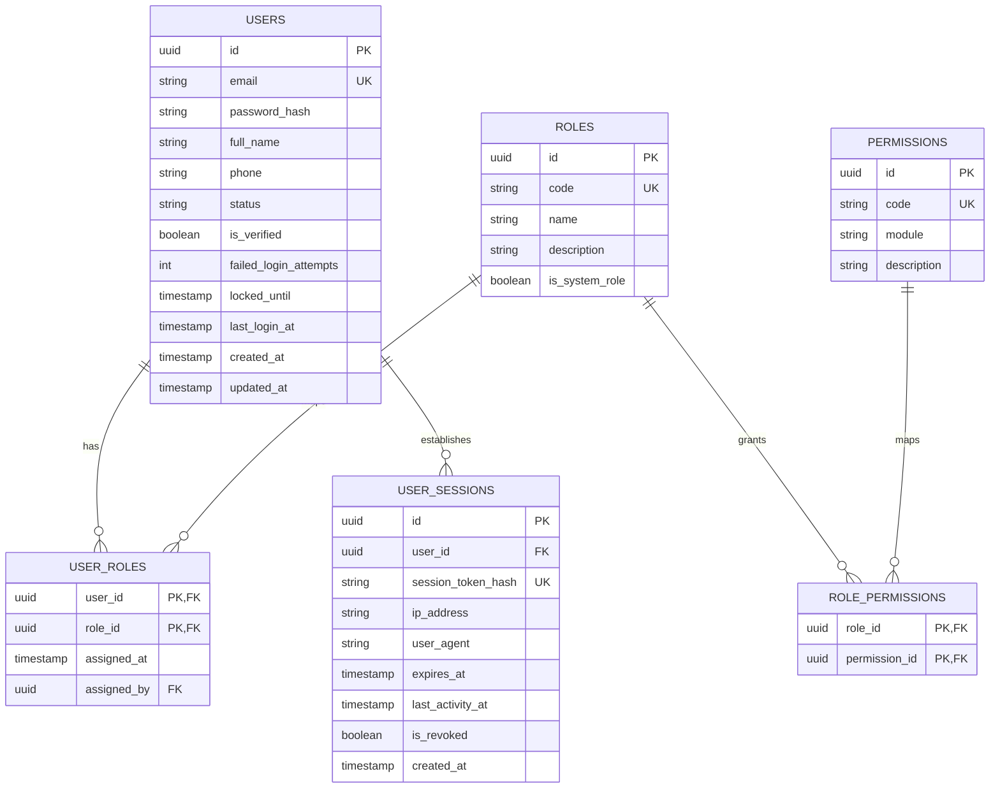
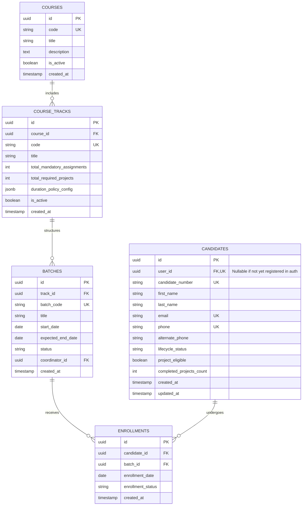
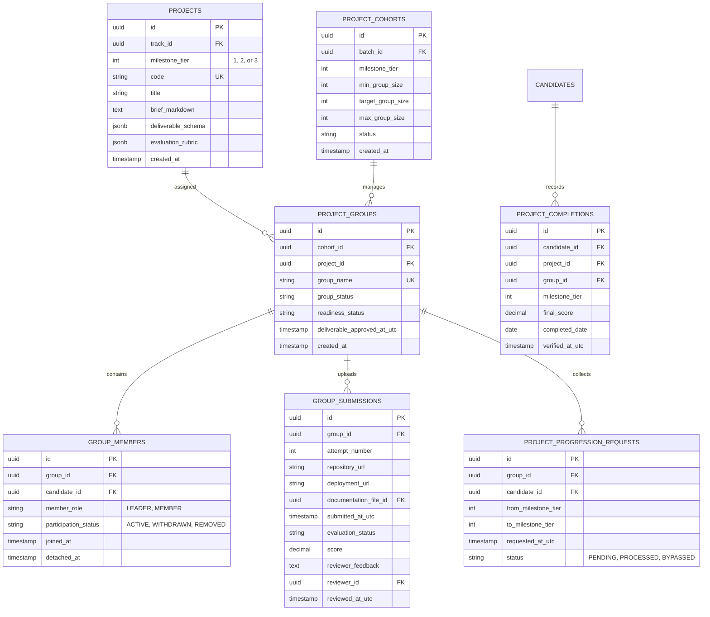
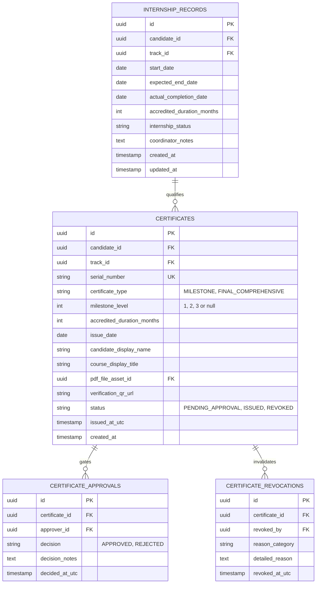

# Entity Relationship Diagram (ERD)
## Project: ExcelR Track360
### Student Lifecycle & Operations Management Platform
**Document Reference:** ERD-TRK360-V1.0  
**Phase:** Phase 2 – System Architecture & Database Design  
**Status:** Approved for Implementation Planning  

---

## 1. Domain Entities & Relationship Overview

The ExcelR Track360 data model is structured across seven core relational domains:

```mermaid
erDiagram
    %% ==========================================
    %% 1. IDENTITY & SESSIONS
    %% ==========================================
    USERS ||--o{ USER_ROLES : has
    ROLES ||--o{ USER_ROLES : assigned_to
    ROLES ||--o{ ROLE_PERMISSIONS : contains
    PERMISSIONS ||--o{ ROLE_PERMISSIONS : granted_by
    USERS ||--o{ USER_SESSIONS : owns
    USERS ||--o{ CANDIDATES : linked_student_user

    %% ==========================================
    %% 2. CANDIDATES & ACADEMIC COHORTS
    %% ==========================================
    COURSES ||--o{ COURSE_TRACKS : offers
    COURSE_TRACKS ||--o{ BATCHES : runs
    BATCHES ||--o{ ENROLLMENTS : contains
    CANDIDATES ||--o{ ENROLLMENTS : enrolled_in
    CANDIDATES ||--o{ CANDIDATE_NOTES : has

    %% ==========================================
    %% 3. ASSIGNMENTS & EVALUATIONS
    %% ==========================================
    COURSE_TRACKS ||--o{ ASSIGNMENTS : defines
    ASSIGNMENTS ||--o{ ASSIGNMENT_ALLOCATIONS : allocated_via
    BATCHES ||--o{ ASSIGNMENT_ALLOCATIONS : targeted_batch
    CANDIDATES ||--o{ ASSIGNMENT_ALLOCATIONS : targeted_candidate
    ASSIGNMENT_ALLOCATIONS ||--o{ ASSIGNMENT_SUBMISSIONS : receives
    ASSIGNMENT_SUBMISSIONS ||--o{ SUBMISSION_ATTEMPTS : versions
    SUBMISSION_ATTEMPTS ||--o{ SUBMISSION_REVIEWS : evaluated_by
    USERS ||--o{ SUBMISSION_REVIEWS : reviewer
    SUBMISSION_REVIEWS ||--o{ REVIEW_RUBRIC_SCORES : scores

    %% ==========================================
    %% 4. PROJECTS & COLLABORATIVE GROUPS
    %% ==========================================
    COURSE_TRACKS ||--o{ PROJECTS : includes
    BATCHES ||--o{ PROJECT_COHORTS : initiates
    PROJECT_COHORTS ||--o{ PROJECT_GROUPS : organizes
    PROJECTS ||--o{ PROJECT_GROUPS : assigned_project
    PROJECT_GROUPS ||--o{ GROUP_MEMBERS : includes
    CANDIDATES ||--o{ GROUP_MEMBERS : participates_in
    PROJECT_GROUPS ||--o{ GROUP_SUBMISSIONS : submits
    GROUP_SUBMISSIONS ||--o{ GROUP_REVIEWS : reviewed_as
    PROJECT_GROUPS ||--o{ PROJECT_PROGRESSION_REQUESTS : requests
    CANDIDATES ||--o{ PROJECT_PROGRESSION_REQUESTS : requested_by
    CANDIDATES ||--o{ PROJECT_COMPLETIONS : earns
    PROJECTS ||--o{ PROJECT_COMPLETIONS : completed_for

    %% ==========================================
    %% 5. INTERNSHIP MILESTONES
    %% ==========================================
    CANDIDATES ||--o{ INTERNSHIP_RECORDS : undertakes
    COURSE_TRACKS ||--o{ INTERNSHIP_RECORDS : under_track
    INTERNSHIP_RECORDS ||--o{ INTERNSHIP_MILESTONES : tracks

    %% ==========================================
    %% 6. CERTIFICATES & CREDENTIALS
    %% ==========================================
    CANDIDATES ||--o{ CERTIFICATES : awarded_to
    COURSE_TRACKS ||--o{ CERTIFICATES : certified_in
    CERTIFICATES ||--o{ CERTIFICATE_APPROVALS : approved_by
    USERS ||--o{ CERTIFICATE_APPROVALS : approver_user
    CERTIFICATES ||--o{ CERTIFICATE_REVOCATIONS : revoked_by
    USERS ||--o{ CERTIFICATE_REVOCATIONS : revoking_user

    %% ==========================================
    %% 7. CROSS-CUTTING AUDIT & FILES
    %% ==========================================
    USERS ||--o{ AUDIT_LOGS : triggered_by
    USERS ||--o{ FILE_ASSETS : uploaded_by
```

---

## 2. Detailed Entity Attributes & Cardinality

### 2.1 Identity, RBAC & Session Domain

### 2.2 Candidates & Academic Curriculum Domain

### 2.3 Assignments, Allocations & Iterative Reviews

```mermaid
erDiagram
    ASSIGNMENTS {
        uuid id PK
        uuid track_id FK
        string code UK
        string title
        text instructions_markdown
        int sequence_order
        boolean is_mandatory
        decimal max_score
        decimal passing_score
        jsonb rubric_template
        jsonb allowed_file_types
        int max_file_size_mb
        timestamp created_at
    }

    ASSIGNMENT_ALLOCATIONS {
        uuid id PK
        uuid assignment_id FK
        uuid batch_id FK "Nullable if individual allocation"
        uuid candidate_id FK "Nullable if batch allocation"
        timestamp due_date_utc
        timestamp grace_period_end_utc
        string allocation_status
        timestamp created_at
    }

    ASSIGNMENT_SUBMISSIONS {
        uuid id PK
        uuid allocation_id FK
        uuid candidate_id FK
        string current_submission_status
        string current_completion_status
        int total_attempts
        decimal latest_score
        timestamp first_submitted_at_utc
        timestamp latest_submitted_at_utc
    }

    SUBMISSION_ATTEMPTS {
        uuid id PK
        uuid submission_id FK
        int attempt_number
        uuid file_asset_id FK "Nullable if repository URL only"
        string repository_url
        text student_notes
        timestamp submitted_at_utc
        boolean is_late
        int lateness_minutes
    }

    SUBMISSION_REVIEWS {
        uuid id PK
        uuid attempt_id FK
        uuid reviewer_id FK
        string review_outcome
        decimal total_score
        text qualitative_feedback
        text internal_evaluator_notes
        timestamp review_completed_at_utc
    }

    REVIEW_RUBRIC_SCORES {
        uuid id PK
        uuid review_id FK
        string criterion_key
        string criterion_title
        decimal max_points
        decimal awarded_points
        text criterion_comments
    }

    ASSIGNMENTS ||--o{ ASSIGNMENT_ALLOCATIONS : instantiates
    ASSIGNMENT_ALLOCATIONS ||--o{ ASSIGNMENT_SUBMISSIONS : targets
    ASSIGNMENT_SUBMISSIONS ||--o{ SUBMISSION_ATTEMPTS : contains
    SUBMISSION_ATTEMPTS ||--o{ SUBMISSION_REVIEWS : undergoes
    SUBMISSION_REVIEWS ||--o{ REVIEW_RUBRIC_SCORES : breaks_down
```

### 2.4 Projects, Groups & Group Readiness

### 2.5 Internship & Certificate Domain

---

## 3. Primary Key & Identifier Strategy

1. **UUIDv7 for Domain Entities:**
   - All operational tables use **UUIDv7** (RFC 9562) as their primary key.
   - *Rationale:* Unlike random UUIDv4, UUIDv7 embeds a millisecond-precision UTC timestamp in the leading 48 bits. This preserves natural chronological B-Tree index locality, eliminating index fragmentation during high-throughput inserts while preventing sequential ID guessing attacks.
2. **Human-Readable Business Codes:**
   - Candidates: `candidate_number` (e.g., `CAN-2026-00042`).
   - Batches: `batch_code` (e.g., `FSD-2026-B12`).
   - Assignments: `code` (e.g., `ASG-PY-001`).
   - Certificates: `serial_number` (e.g., `EXCELR-2026-FSD-7D2A1B8C`).

---

## 4. Key Performance Indexes

| Table | Index Columns | Index Type | Purpose |
| :--- | :--- | :--- | :--- |
| `candidates` | `LOWER(TRIM(email))` | B-Tree Unique | Case-insensitive email de-duplication |
| `candidates` | `phone` | B-Tree Unique | Mobile phone de-duplication |
| `candidates` | `(lifecycle_status, project_eligible)` | B-Tree Partial | High-speed filtering of project-ready candidates |
| `assignment_allocations` | `(candidate_id, assignment_id)` | B-Tree Unique | Prevents duplicate allocation of same assignment |
| `submission_attempts` | `(submission_id, attempt_number)` | B-Tree Unique | Enforces sequential attempt versioning |
| `group_members` | `(group_id, candidate_id)` | B-Tree Unique | Prevents duplicate candidate membership in group |
| `project_groups` | `(cohort_id, readiness_status)` | B-Tree | High-speed lookup for blocked/ready groups |
| `certificates` | `serial_number` | B-Tree Unique | Constant-time ($O(1)$) public certificate verification |
| `certificates` | `(candidate_id, certificate_type, milestone_level)` | Partial Unique (`status != 'REVOKED'`) | Blocks duplicate active certificate issuance |
| `audit_logs` | `(entity_type, entity_id, created_at)` | B-Tree | Fast retrieval of entity audit history |
