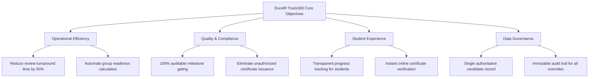
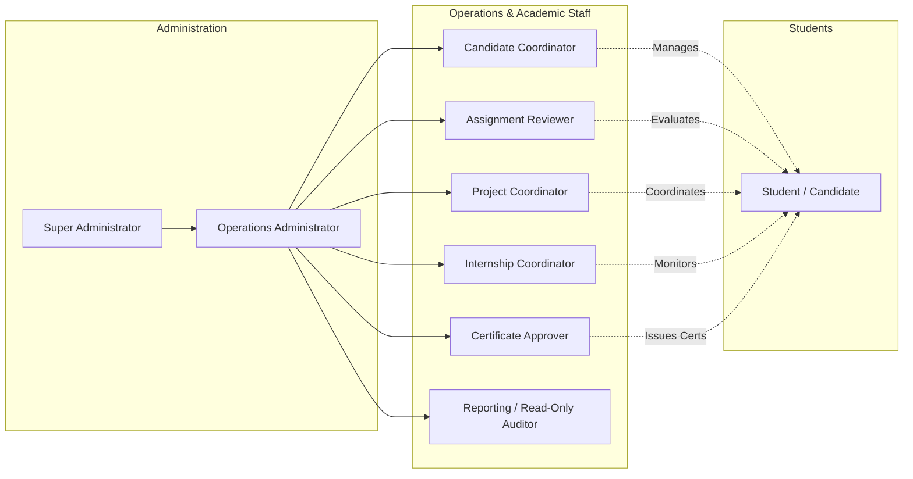
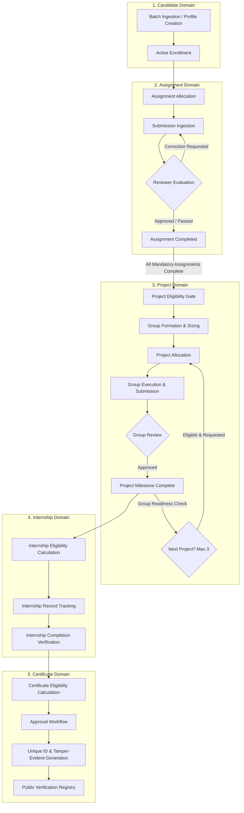

# Business Requirements Document (BRD)
## Project: ExcelR Track360
### Student Lifecycle & Operations Management Platform
**Tagline:** Track Every Student. Every Assignment. Every Milestone.  
**Document Reference:** BRD-TRK360-V1.0  
**Phase:** Phase 1 – Requirements & Business Analysis  
**Status:** Baseline Draft for Stakeholder Review  

---

## 1. Executive Summary & Purpose

ExcelR currently delivers technical training, internship, and project-based educational programs across diverse cohorts. As cohort sizes and program tracks expand, core operational processes—tracking candidate progress, reviewing multi-stage assignment submissions, coordinating collaborative group projects, monitoring internship milestones, and issuing verified completion certificates—have become increasingly fragmented across disconnected spreadsheets, email threads, and manual chat communications.

**ExcelR Track360** is conceived as an enterprise-grade, internal operational platform designed to unify the entire student lifecycle into a single authoritative system of record. By replacing error-prone manual spreadsheets with automated, auditable, and role-governed workflows, Track360 ensures:
1. **Zero Record Duplication:** One golden candidate profile spanning enrollment to certification.
2. **Deterministic Milestone Progression:** Strict, system-enforced prerequisites preventing unauthorized or premature milestone advancement.
3. **Operational Visibility:** Real-time dashboards, SLA monitoring for reviews, and bottleneck detection across assignment queues and project cohorts.
4. **Data Integrity & Compliance:** Tamper-evident certificate verification, immutable audit logging, and role-based data protection.

---

## 2. Business Problem Statement

Operating candidate lifecycles via spreadsheets and email presents acute operational and pedagogical risks:

| Operational Area | Current Manual Approach | Business Risk & Pain Point |
| :--- | :--- | :--- |
| **Candidate Identity** | Multiple Excel sheets across trainers, coordinators, and placement teams. | Fragmented data, conflicting contact details, duplicated student profiles, and loss of historical records. |
| **Assignment Lifecycle** | Email submissions or Google Drive links shared in chat groups. | Missed submission deadlines, lost attachments, lack of server-verified timestamps, subjective review turnaround times, and unpreserved review histories. |
| **Project Allocation** | Manual evaluation of spreadsheet rows to check who completed which assignment. | Students allocated to projects prematurely without completing prerequisite assignments; lack of clear eligibility gating. |
| **Group Coordination** | Manual group formation (e.g., 4 students per group) tracked in spreadsheets. | High friction when candidates drop out, fall inactive, or lag behind; group progress stalls indefinitely without clear business rules or automated readiness alerts. |
| **Internship Tracking** | Ad-hoc spreadsheet tracking of months and project completion. | Inconsistent duration calculations; confusion between calendar internship dates and certificate eligibility durations. |
| **Certificate Issuance** | Manually designed certificates issued via email on student demand. | Risk of duplicate issuance, unauthorized issuance, lack of public verification, and administrative burnout generating manual certificates. |
| **Executive Reporting** | Manual weekly consolidation of spreadsheets. | Stale data, lack of reliable operational metrics, and no visibility into reviewer bottlenecks or dropout trends. |

---

## 3. Business Goals & Key Performance Indicators (KPIs)

Track360 is built to achieve the following quantifiable business objectives:

### Key Performance Indicators (KPIs)
1. **Administrative Time Savings:** Reduce coordinator hours spent on manual tracking and spreadsheet reconciliation by at least 65% within 90 days of deployment.
2. **Review SLA Adherence:** Maintain a 48-hour SLA for assignment evaluations with automated reviewer queue dispatch and escalation alerts.
3. **Milestone Integrity:** 0% occurrence of candidates allocated to projects or issued certificates without verified prerequisite completion in the system.
4. **Duplicate Record Rate:** Maintain zero duplicate candidate profiles across all batches and courses.
5. **Certificate Trust & Verification:** 100% of issued certificates backed by a cryptographically unique identifier and instant public verification link.

---

## 4. Stakeholders & User Roles Overview

Track360 serves nine distinct internal and external user groups. Access is governed by strict Role-Based Access Control (RBAC) enforced on the server.

### Stakeholder Role Summary
1. **Super Administrator:** Complete system authority, global configuration, user provisioning, security policies, and unconstrained audit access.
2. **Operations Administrator:** Manages day-to-day cohort setups, course structures, reviewer allocations, batch assignments, and operational escalations.
3. **Candidate Coordinator:** Manages candidate profiles, batch enrollments, contact updates, enrollment status transitions, and bulk CSV ingestion.
4. **Assignment Reviewer:** Dedicated academic evaluator who reviews student submissions, provides structured feedback, requests corrections, and scores assignments.
5. **Project Coordinator:** Manages project catalogs, group formations, group readiness checks, project allocations, and group deliverable evaluations.
6. **Internship Coordinator:** Tracks internship commencement, monitors milestone progress against project achievements, and confirms internship completion.
7. **Certificate Approver:** Independent authority empowered to verify prerequisite milestones, approve certificate issuance requests, and sign off on credentials.
8. **Reporting / Read-Only User:** Auditor or executive requiring read-only visibility into operational dashboards, SLA reports, and student registries without edit or approval rights.
9. **Student / Candidate:** Authenticated portal user who tracks their individual progress, views assignment briefs, submits deliverables, views reviewer feedback, tracks group status, and accesses issued certificates.

---

## 5. Core Business Domains & Scope

### 5.1 Candidate Lifecycle & Identity Management
- **One Authoritative Profile:** Maintains biographical, contact, batch, enrollment, assignment, project, internship, and certificate history in a consolidated record.
- **De-duplication Engine:** Prevents duplicate candidate registration via unique constraints across primary email, mobile phone, and student enrollment ID.
- **Batch CSV Ingestion:** Empowers staff to import cohort spreadsheets with rigorous pre-import validation, dry-run previews, and detailed row-by-row error reporting.
- **Status Lifecycle:** Tracks candidate lifecycle states: `Enrolled`, `Active`, `On Hold`, `Dropped/Withdrawn`, `Completed`, and `Alumni`.

### 5.2 Assignment & Assessment Management
- **Question & Instruction Repository:** Centralized assignment authoring supporting instructions, reference files, rubrics, and deadlines.
- **Dual Allocation Models:** Supports assignment allocation at both the cohort/batch level and individual candidate level for remedial or custom tracks.
- **Authoritative Server Timestamps:** Records UTC submission timestamps at the exact moment bytes are received, eliminating client-side clock tampering.
- **Iterative Review & Resubmission Engine:** Facilitates multi-round reviews (`Submitted` -> `Under Review` -> `Corrections Requested` -> `Resubmitted` -> `Approved`/`Rejected`). Preserves complete version history of all submissions, reviewer notes, and rubrics.
- **Submission vs Completion Distinction:** Explicitly decouples submission from completion. An assignment is only completed when marked `Approved` by an authorized reviewer.
- **Overdue & SLA Tracking:** Automatically flags pending submissions past deadline and reviews exceeding staff turnaround targets.

### 5.3 Project & Collaborative Group Management
- **Project Library:** Curated catalog of industry projects with specifications, architectural guidelines, and submission requirements.
- **Strict Prerequisite Gating:** Enforces that a candidate cannot be allocated to a project until 100% of required assignments in their curriculum are marked `Approved`.
- **Configurable Group Sizing:** Dynamic group formation supporting custom group sizes (not hardcoded to 4).
- **Group Readiness & Bottleneck Logic:** Before progressing to the subsequent project, the platform evaluates whether all required group members have completed deliverables and requested progression.
- **Multi-Project Cap:** Enforces a business policy limit of a maximum of three (3) completed projects per candidate, unless an authorized administrator approves a policy exception.
- **Exception & Inactive Member Resolution:** Standardized operational pathways to handle inactive, withdrawn, or lagging group members without penalizing high-performing peers.

### 5.4 Internship Milestone Management
- **Decoupled Records:** Distinguishes between formal internship eligibility, internship record commencement/conclusion, and certificate issuance.
- **Configurable Duration Mapping Policy:** Proposes default policy:
  - 1 Completed Project $\rightarrow$ 3 Months Internship Duration.
  - 2 Completed Projects $\rightarrow$ 6 Months Internship Duration.
  - 3 Completed Projects $\rightarrow$ 9 Months Internship Duration.
- **Calendar Dates Independence:** Explicitly separates the calculated milestone duration from actual real-world calendar start and end dates.

### 5.5 Certificate Management
- **Eligibility Verification:** Calculates certificate eligibility strictly based on verified system records (completed assignments, evaluated projects, confirmed internship milestones).
- **Independent Approval Chain:** Enforces a dedicated approval step by a `Certificate Approver` before credentials can be generated.
- **Tamper-Evident Generation:** Assigns an immutable, globally unique certificate identifier (UUID/Serial), embeds a verification QR code, and produces high-fidelity PDFs.
- **Public Verification Portal:** Provides a secure, tokenized public verification web page allowing employers and third parties to authenticate credentials without login.
- **Duplicate Issuance Prevention:** Enforces idempotency and constraint checks preventing accidental multi-issuance of identical credentials.

### 5.6 Operational Reporting & Audit Management
- **Audit Logging:** Immutably records every security-sensitive action, status change, grade modification, and administrative override with actor ID, timestamp, and IP address.
- **Real-Time Dashboards:** Tailored operational cockpits for Coordinators, Reviewers, and Executives.
- **Role-Governed Data Export:** Permits CSV/Excel exports strictly to authorized roles with automatic logging of export operations.

---

## 6. Scope Boundaries

### In-Scope (Phases 1 through 18)
- Complete internal web application for administrative staff, reviewers, coordinators, and students.
- Candidate enrollment, tracking, and profile lifecycle.
- Assignment definition, allocation, submission ingestion, review workflows, and versioned history.
- Project catalog, group builder, allocation matrix, group deliverable review, and group readiness calculation.
- Internship milestone tracking, date logging, and duration policy calculation.
- Certificate eligibility verification, multi-stage approval, PDF generation, and public verification portal.
- Event-driven in-app notifications and email dispatch queue.
- Operational analytics, SLA monitoring, and role-based data export.
- Server-side session management, authentication, and granular RBAC.

### Out-of-Scope (Explicitly Excluded from Core Platform)
- In-platform live video conferencing or streaming classrooms (Zoom/Teams integrations are handled externally via link sharing).
- Payment gateway processing and fee collection (handled by existing accounting software).
- Direct integration with third-party Learning Management Systems (LMS) SCORM packages.
- Native mobile applications (iOS/Android) for initial release (responsive web design will support mobile browsers).
- Automated plagiarism code scanners (can be integrated via webhooks in future phases).

---

## 7. Business Assumptions & Constraints

### Assumptions
1. Candidates possess basic computer literacy and standard web browser access.
2. ExcelR operational teams will administer the platform via desktop/laptop viewports.
3. System-generated emails will be routed through standard organizational SMTP/Transactional email services.
4. Server clocks will operate exclusively on Coordinated Universal Time (UTC), with localized rendering on client browsers.

### Constraints
1. **Zero Real PII in Development:** Development, testing, and staging environments must utilize synthesized test data. Real candidate records shall never be loaded into unapproved environments.
2. **Server-Side Enforcement:** Frontend UI state, button masking, and route guards are strictly convenience layers. All security, validation, state transitions, and authorization checks must be enforced authoritatively on the backend.
3. **No Direct Production Database Edits:** All database structural modifications must be executed through versioned Alembic migrations.
4. **Historical Immutability:** Assignment submission attempts, evaluator comments, grade revisions, and certificate records must be preserved permanently for auditability.

---

## 8. Requirements Traceability Matrix

Every business requirement defined in this document maps directly to technical specifications in `SRS.md`, business rules in `BUSINESS_RULES.md`, and testable criteria in `ACCEPTANCE_CRITERIA.md`.
