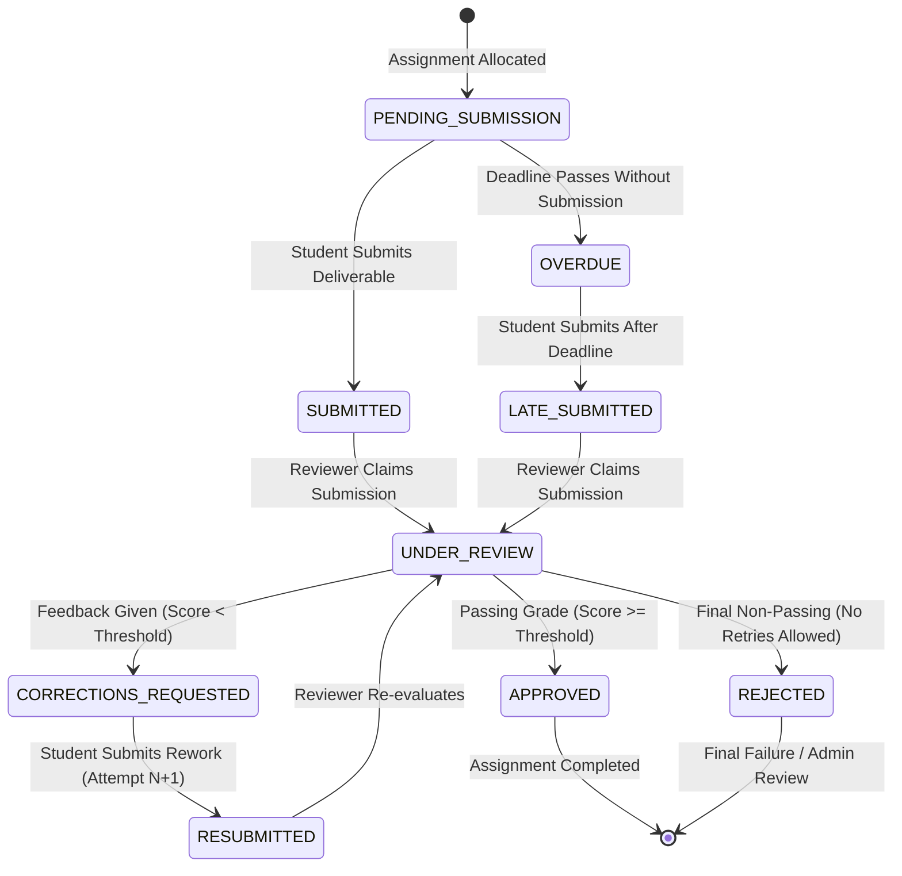
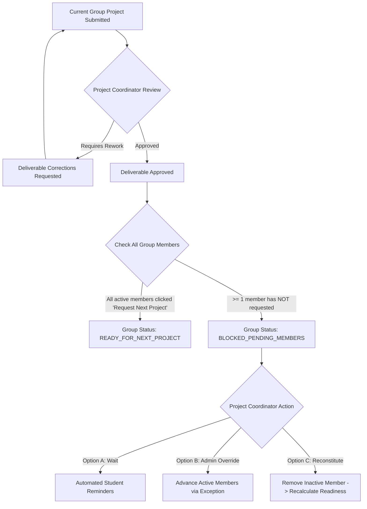

# Business Rules Specification
## Project: ExcelR Track360
### Student Lifecycle & Operations Management Platform
**Document Reference:** BRL-TRK360-V1.0  
**Phase:** Phase 1 – Requirements & Business Analysis  
**Status:** Baseline Specification  

---

## 1. Candidate Management Rules (BR-CAN)

### BR-CAN-01: Authoritative Golden Profile
- **Rule:** A candidate shall have exactly one primary profile record within the platform across their entire educational lifecycle.
- **Enforcement:** Uniqueness is enforced on:
  1. Primary Email (`normalized_email = LOWER(TRIM(email))`)
  2. Mobile Phone Number (normalized E.164 format)
  3. External Enrollment ID
- **Behavior:** Registration or batch import attempts with an existing identifier are blocked with an HTTP 409 conflict, linking back to the existing candidate record.

### BR-CAN-02: Lifecycle State Integrity
- **Rule:** A candidate must exist in exactly one primary lifecycle status at any given time.
- **Allowed States:**
  - `ENROLLED`: Registered in system; awaiting batch commencement.
  - `ACTIVE`: Actively attending curriculum, eligible for assignment allocations.
  - `ON_HOLD`: Temporarily paused (e.g., medical leave, fee deferral); assignment allocations paused.
  - `DROPPED`: Discontinued or terminated; revoked access to active groups.
  - `COMPLETED`: Successfully finished curriculum, projects, and internships.
  - `ALUMNI`: Retained archival state with read-only credential access.
- **Enforcement:** Transitions require an authorized actor. Transitioning to `ON_HOLD` or `DROPPED` requires a mandatory reason category and textual justification.

---

## 2. Assignment Management Rules (BR-ASG)

### BR-ASG-01: Decoupling of Submission, Review, and Completion
- **Rule:** A submitted assignment shall **never** automatically become an approved or completed assignment.
- **State Separation:**
  1. **Submission State:** Tracks whether deliverables have been provided by the candidate (`PENDING`, `SUBMITTED`, `LATE_SUBMITTED`).
  2. **Review State:** Tracks staff evaluation progress (`UNASSIGNED`, `UNDER_REVIEW`, `CORRECTIONS_REQUESTED`, `EVALUATED`).
  3. **Completion State:** Tracks curricular fulfillment (`INCOMPLETE`, `PASSED_COMPLETED`, `FAILED`).
- **Enforcement:** An assignment reaches `PASSED_COMPLETED` if and only if an authorized reviewer explicitly marks the evaluation as `APPROVED` with a score $\ge$ passing threshold.

### BR-ASG-02: Authoritative Server-Side Timestamping
- **Rule:** All submission times shall be determined exclusively by the database server's UTC clock at the moment the complete request payload is received.
- **Enforcement:** Client-side timestamps are discarded. If `server_timestamp > allocation_due_date`, the system automatically sets `is_late = TRUE` and records the lateness delta in minutes.

### BR-ASG-03: Attempt Versioning & Historical Immutability
- **Rule:** Every round of student submission and reviewer feedback must be preserved as an immutable `SubmissionAttempt` record.
- **Enforcement:** When a student resubmits after `CORRECTIONS_REQUESTED`, previous files, comments, and rubrics are archived. Evaluators can toggle between Attempt 1, Attempt 2, etc., during subsequent reviews.

### BR-ASG-04: Passing Thresholds & Weightage
- **Rule:** An assignment has a defined `max_score` and `passing_score` (default: 60%).
- **Enforcement:** The system prevents saving an `APPROVED` review status if the entered score is below `passing_score`, unless the reviewer selects an explicit administrative waiver with justification.

---

## 3. Project Management Rules (BR-PRJ)

### BR-PRJ-01: Prerequisite Gating (100% Assignment Rule)
- **Rule:** A candidate becomes eligible for allocation to Project 1 **only after** 100% of the mandatory curriculum assignments in their enrolled track are marked `APPROVED` / `PASSED_COMPLETED`.
- **Enforcement:** The project allocation engine performs an automated prerequisite check:
  $$\text{Eligibility} = \left( \sum \text{Approved Mandatory Assignments} == \text{Total Mandatory Assignments in Track} \right)$$
- **Exception:** An Operations Administrator may execute a manual prerequisite waiver, requiring documented academic justification logged in the audit trail.

### BR-PRJ-02: Maximum Project Cap (Max 3 Projects)
- **Rule:** Under standard organizational curriculum, a candidate may complete a maximum of three (3) projects:
  - Milestone 1: Project 1 (Foundational)
  - Milestone 2: Project 2 (Intermediate)
  - Milestone 3: Project 3 (Advanced Capstone)
- **Enforcement:** The system automatically blocks allocation of a 4th project to any candidate unless a `Super Administrator` activates a specialized policy extension.

### BR-PRJ-03: Dynamic Group Sizing (No Hardcoding)
- **Rule:** Project group sizes must be dynamically configurable per cohort, track, or project template.
- **Enforcement:** The system defines a project group policy schema:
  - `min_group_size`: Lower bound (default: 2)
  - `target_group_size`: Recommended size (default: 4)
  - `max_group_size`: Upper bound (default: 5)
  - Individual projects (`size = 1`) are supported when configured for capstones or solo tracks.
- **Constraint:** Hardcoded assumptions that group size is always 4 are strictly prohibited in application code and schema.

### BR-PRJ-04: Single Active Project Constraint
- **Rule:** A candidate shall not be allocated to multiple active project groups concurrently.
- **Enforcement:** Attempting to assign a candidate with an active project in status `IN_PROGRESS` or `UNDER_REVIEW` will trigger a validation error.

---

## 4. Collaborative Group Readiness Rules (BR-GRP)

### BR-GRP-01: Group Readiness Definition
- **Rule:** In collaborative group projects, progression to the next milestone or subsequent project requires the entire group to be evaluated and ready.
- **Baseline Readiness Conditions:** A group is designated `READY_FOR_NEXT_PROJECT` if and only if:
  1. The current group project deliverable is marked `APPROVED`.
  2. Every currently active member of the group has submitted an individual "Request to Proceed".
  3. No active member has an unresolved `CORRECTIONS_REQUESTED` item.

### BR-GRP-02: Handling Inactive, Withdrawn, or Lagging Group Members
When one or more members block the group from proceeding, the platform supports four operational pathways:

| Scenario | System Rule & Operational Workflow | System State Transition | Authority Required |
| :--- | :--- | :--- | :--- |
| **Member Lagging (< 7 days)** | Automated daily reminder notifications sent to pending member; group remains in `BLOCKED_PENDING_MEMBERS`. | None (Pending) | System Automation |
| **Member Inactive / Non-responsive (> 7 days)** | Coordinator issues a formal "Intent to Remove" notice. If unacknowledged within 48h, coordinator removes member from group. | Removed candidate $\rightarrow$ `UNASSIGNED_FROM_PROJECT`; Group recalculates readiness immediately. | Project Coordinator |
| **Candidate Withdrawn / Dropped** | When candidate status changes to `DROPPED` or `ON_HOLD`, they are automatically detached from active project groups. | Group member count decrements; readiness evaluated against remaining active members. | Candidate Coordinator / Operations Admin |
| **Split Group Reconstitution** | If a 4-person group splits into 2 active students and 2 delayed students, coordinator can split into two groups: Group A (advances to Project 2) and Group B (remains on Project 1). | Original group archived; two new groups created with historical deliverable links preserved. | Project Coordinator |
| **Administrative Override** | Coordinator approves progression for ready members without removing delayed members (pending business approval). | Group advances; delayed member flagged as `BEHIND_MILESTONE`. | Operations Administrator |

*(Note: The exact timeout durations and default split behavior are documented in `OPEN_BUSINESS_QUESTIONS.md` for executive confirmation).*

---

## 5. Internship Milestone Rules (BR-INT)

### BR-INT-01: Decoupling of Internship Lifecycle from Certificate Duration
- **Rule:** The platform must treat real-world internship scheduling as a distinct operational entity from certified milestone duration.
- **Distinction Matrix:**

| Concept | Meaning | Driven By | System Entity |
| :--- | :--- | :--- | :--- |
| **Internship Eligibility** | Candidate satisfies academic criteria to begin internship. | Assignment approval & Project 1 readiness. | Calculated Flag |
| **Internship Record** | The operational tracking of a candidate's formal internship. | Corporate enrollment or internal allocation. | `InternshipRecord` |
| **Internship Start Date** | The calendar date work or training commenced. | Staff entry or batch kickoff date. | `start_date` (Date) |
| **Internship End Date** | The calendar date work concluded. | Staff entry or milestone completion. | `end_date` (Date) |
| **Accredited Duration** | Total duration credited toward certification. | Completed project milestones policy. | `accredited_months` (Int) |

### BR-INT-02: Configurable Project-to-Internship Duration Policy
- **Rule:** Accredited internship duration shall be calculated using a configurable policy matrix:
  - Policy Tier 1: 1 Approved Project $\rightarrow$ 3 Months Accredited Internship Duration
  - Policy Tier 2: 2 Approved Projects $\rightarrow$ 6 Months Accredited Internship Duration
  - Policy Tier 3: 3 Approved Projects $\rightarrow$ 9 Months Accredited Internship Duration
- **Enforcement:** The duration multiplier (3 months per completed project) is stored in the system configuration table. If leadership adjusts the policy (e.g., 2 months per project for specialized tracks), the engine applies the configured parameter.

---

## 6. Certificate Management Rules (BR-CER)

### BR-CER-01: Verified Eligibility Prerequisite Gate
- **Rule:** A certificate record cannot be initialized or approved unless the candidate satisfies all prerequisite milestones:
  1. 100% of required curriculum assignments marked `PASSED_COMPLETED`.
  2. Required project milestone(s) marked `APPROVED`.
  3. Internship record status marked `COMPLETED` or `VERIFIED`.
- **Constraint:** A candidate request or coordinator initiation alone cannot bypass automated milestone verification.

### BR-CER-02: Mandatory Two-Stage Approval
- **Rule:** Every certificate must pass through an electronic approval gate signed off by a designated `Certificate Approver`.
- **Workflow:**
  1. Candidate completes criteria $\rightarrow$ System sets `ELIGIBLE_FOR_CERTIFICATE`.
  2. Coordinator submits `REQUEST_ISSUANCE`.
  3. Certificate Approver inspects audit trail $\rightarrow$ Clicks `APPROVE_ISSUANCE` (or `REJECT` with reason).
  4. System transitions record to `ISSUED` and generates PDF artifact.

### BR-CER-03: Unique Certificate Identification & Serial Numbering
- **Rule:** Every issued certificate receives an unguessable, cryptographically generated verification serial number.
- **Format:** `EXCELR-[YEAR]-[TRACK_CODE]-[8_CHAR_ALPHANUMERIC]` (e.g., `EXCELR-2026-FSD-9C4E2A8F`).
- **Enforcement:** Database unique constraint on serial number. Embeds dynamic verification URL (`https://track360.excelr.com/verify/EXCELR-2026-FSD-9C4E2A8F`) and QR code on the PDF.

### BR-CER-04: Duplicate Issuance Prevention
- **Rule:** A candidate cannot be issued duplicate active certificates for the same completed milestone.
- **Enforcement:** Unique database constraint on `(candidate_id, certificate_type, milestone_level)` where `status != 'REVOKED'`. Re-issuing due to typographical error requires explicit revocation or updating of the existing certificate record.

### BR-CER-05: Milestone Issuance Policy vs. Final Issuance Policy
- **Open Policy Options:**
  - *Option A (Milestone-Based):* Candidate receives an intermediate certificate after Project 1 (3-month), Project 2 (6-month), and Project 3 (9-month).
  - *Option B (Final Exit Only):* Candidate receives exactly one comprehensive certificate upon exit, reflecting their total completed duration (3, 6, or 9 months).
  - *Default Baseline:* Option B is configured as baseline, with system architecture capable of supporting Option A pending stakeholder sign-off (see `OPEN_BUSINESS_QUESTIONS.md`).

---

## 7. Administrative Exception Handling Rules (BR-EXC)

### BR-EXC-01: Mandatory Justification & Immutability
- **Rule:** Whenever an administrator overrides an automated business rule (e.g., prerequisite assignment waiver, project cap extension, group readiness bypass, manual score adjustment):
  1. The user must provide a mandatory textual explanation ($\ge 20$ characters).
  2. The system creates an immutable record in the `AuditLog` table containing: `actor_id`, `target_entity`, `action_name`, `pre_state`, `post_state`, `justification`, `timestamp_utc`, `client_ip`.
  3. Overrides cannot be deleted or pruned from the audit log.

### BR-EXC-02: Role Boundaries for Exceptions
- **Rule:**
  - `Assignment Reviewer` cannot override prerequisite rules.
  - `Project Coordinator` can override group readiness bottlenecks within their assigned cohorts.
  - `Operations Administrator` can waive assignment prerequisites for project entry.
  - Only `Super Administrator` can override maximum project caps (4+ projects) or reverse certificate revocations.
