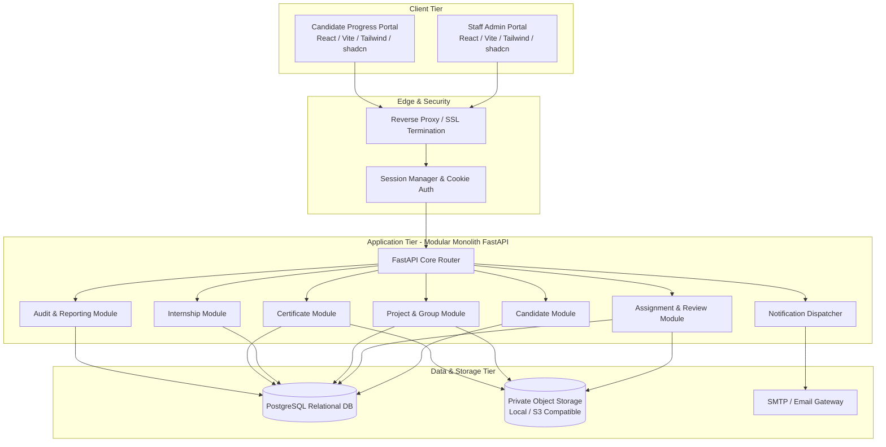

# Software Requirements Specification (SRS)
## Project: ExcelR Track360
### Student Lifecycle & Operations Management Platform
**Document Reference:** SRS-TRK360-V1.0  
**Phase:** Phase 1 – Requirements & Business Analysis  
**Status:** Baseline Specification  

---

## 1. Introduction

### 1.1 Purpose
This Software Requirements Specification (SRS) establishes the formal functional and non-functional requirements for the **ExcelR Track360** platform. Track360 is an enterprise web application designed to manage and orchestrate the complete student lifecycle: candidate profiling, cohort enrollment, assignment evaluation, collaborative group project allocation, internship milestone tracking, verified credential issuance, and operational reporting.

### 1.2 Scope of the Software
The software provides:
1. **Administrative Operations Portal:** A role-governed desktop web interface for coordinators, reviewers, administrators, and leadership.
2. **Student Learning & Progress Portal:** A responsive web interface enabling candidates to view curriculum benchmarks, upload submissions, review detailed evaluator feedback, monitor group milestone readiness, and access certified credentials.
3. **Core Application Service:** A modular monolith API backend managing persistent relational data, state machines, business rule enforcement, background email dispatching, file access tokens, and reporting.

### 1.3 Definitions, Acronyms, and Abbreviations
- **RBAC:** Role-Based Access Control
- **PII:** Personally Identifiable Information
- **SLA:** Service Level Agreement (specifically review turnaround time)
- **UTC:** Coordinated Universal Time
- **UUID:** Universally Unique Identifier
- **QR Code:** Quick Response Code (for tamper-evident certificate verification)
- **SoD:** Separation of Duties
- **Dry-Run:** Pre-execution validation of batch data without persistent database writes

---

## 2. Overall System Description

### 2.1 Product Perspective & Architectural Overview
Track360 is structured as a **modular monolith** web application. It integrates a Single Page Application (SPA) frontend with a stateless RESTful backend backed by a relational database and private object storage.

### 2.2 Technology Stack
- **Frontend:** React 18+, TypeScript, Vite, Tailwind CSS, shadcn/ui component primitives, React Router v6, TanStack Query v5, React Hook Form, Zod.
- **Backend:** Python 3.11+, FastAPI, SQLAlchemy 2.0 (async/declarative), Alembic migrations, Pydantic v2 schemas.
- **Database:** PostgreSQL 15+.
- **Testing:** Pytest, HTTPX, Vitest, React Testing Library.
- **Infrastructure:** Docker, Docker Compose, Git.

---

## 3. Functional Requirements

### 3.1 Candidate Lifecycle Management (FR-CAN)

#### FR-CAN-001: Single Authoritative Candidate Profile
- **Type:** Mandatory
- **Description:** The system shall maintain exactly one master profile for each enrolled candidate, linking contact details, enrollment batch, assignment progress, project records, internship milestones, and issued certificates.
- **Inputs:** Candidate name, primary email, secondary email, mobile phone, alternate phone, academic background, enrollment date, assigned batch ID, course track ID.
- **Processing:** Validates uniqueness, formats phone numbers to E.164, associates with primary batch, sets initial status to `Enrolled`.
- **Outputs:** Unique Candidate UUID, generated Candidate Enrollment ID, active profile view.

#### FR-CAN-002: Duplicate Candidate Prevention
- **Type:** Mandatory
- **Description:** The system shall enforce strict uniqueness constraints to prevent duplicate candidate registrations.
- **Processing:** System-level unique constraints and pre-insertion checks against:
  1. Normalized primary email address (case-insensitive).
  2. Mobile phone number.
  3. External Enrollment ID.
- **Outputs:** If duplicate detected, transaction is rolled back with HTTP 409 Conflict detailing matching fields.

#### FR-CAN-003: Batch CSV Import with Dry-Run Validation
- **Type:** Mandatory
- **Description:** Staff shall be able to import candidate rosters via CSV files with real-time validation and preview before persistent ingestion.
- **Processing:**
  1. Inspects CSV headers against standard schema.
  2. Validates field data types, required fields, and format patterns.
  3. Checks for internal duplicates within the CSV and existing records in the database.
  4. Returns a detailed validation summary (Valid Rows, Errored Rows with line numbers and specific failure reasons).
  5. Commits to database only upon explicit user confirmation of a passing validation.
- **Outputs:** Import confirmation report and batch generation log.

#### FR-CAN-004: Advanced Candidate Search, Filtering, and Pagination
- **Type:** Mandatory
- **Description:** Authorized staff shall search, filter, sort, and paginate through candidate records efficiently.
- **Filter Parameters:** Batch ID, Course Track, Current Lifecycle Status (`Enrolled`, `Active`, `On Hold`, `Dropped`, `Completed`), Project Eligibility Status, Assignment Progress Range.
- **Outputs:** Paginated result set with total count, active filter metadata, and sorting parameters.

#### FR-CAN-005: Candidate Lifecycle Status Transitions
- **Type:** Mandatory
- **Description:** Candidate status transitions shall be strictly governed by defined lifecycle rules: `Enrolled` $\rightarrow$ `Active` $\rightarrow$ `On Hold` $\rightarrow$ `Dropped` $\rightarrow$ `Completed` $\rightarrow$ `Alumni`.
- **Processing:** State transitions require authorized role credentials and a mandatory audit reason for non-standard transitions (e.g., `On Hold` or `Dropped`).

---

### 3.2 Assignment & Assessment Management (FR-ASG)

#### FR-ASG-001: Assignment Definition & Template Management
- **Type:** Mandatory
- **Description:** Staff shall define assignment templates including title, curriculum module, detailed markdown instructions, reference files, maximum score, passing threshold score, and due dates.
- **Outputs:** Reusable assignment template registered in catalog.

#### FR-ASG-002: Cohort & Individual Assignment Allocation
- **Type:** Mandatory
- **Description:** Staff shall allocate assignments either to an entire cohort/batch or selectively to individual candidates.
- **Processing:** Creates a unique `AssignmentAllocation` record for each eligible candidate with status `Pending Submission`.

#### FR-ASG-003: Submission Ingestion & File Restrictions
- **Type:** Mandatory
- **Description:** Candidates shall submit assignments via text repository link, file upload, or inline response depending on assignment configuration.
- **Constraints:**
  - Allowed file types: `.pdf`, `.zip`, `.tar.gz`, `.ipynb`, `.docx`. Executable files (`.exe`, `.sh`, `.bat`) are strictly rejected.
  - Maximum upload size per file: 25 MB (configurable up to 50 MB by Super Admin).
  - Files are stored in private storage with randomized, non-guessable storage keys.

#### FR-ASG-004: Server-Authoritative Timestamping
- **Type:** Mandatory
- **Description:** The system shall record submission timestamps using server-generated UTC time at the moment the payload is received.
- **Processing:** Evaluates whether submission timestamp $\le$ allocation due date. Sets `is_late` flag to `True` if received after the deadline. Client-supplied timestamps shall be ignored.

#### FR-ASG-005: Iterative Review & Feedback Workflow
- **Type:** Mandatory
- **Description:** Assignment Reviewers shall inspect student submissions, enter rubric-based scores, and record textual feedback.
- **State Machine:**
  - `Submitted` $\rightarrow$ `Under Review` $\rightarrow$ `Approved` (Pass)
  - `Submitted` $\rightarrow$ `Under Review` $\rightarrow$ `Corrections Requested` (Requires rework)
  - `Submitted` $\rightarrow$ `Under Review` $\rightarrow$ `Rejected` (Fail without resubmission)
- **Constraint:** A submitted assignment shall never automatically transition to `Approved`. Approval requires explicit action by an authorized reviewer.

#### FR-ASG-006: Correction Request & Resubmission History
- **Type:** Mandatory
- **Description:** When corrections are requested, the candidate shall be notified and permitted to submit a revised payload.
- **Processing:** Creates a new `SubmissionAttempt` record (e.g., Attempt #2, #3). All prior submission files, timestamps, reviewer notes, and scores are preserved immutably.

#### FR-ASG-007: Assignment Completion Calculation
- **Type:** Mandatory
- **Description:** An assignment is marked `Completed` if and only if the latest review status is `Approved` and the achieved score $\ge$ passing threshold.

#### FR-ASG-008: Overdue & SLA Tracking
- **Type:** Proposed Enhancement
- **Description:** The system shall automatically flag pending student assignments past their due date and reviewer submissions awaiting evaluation longer than the 48-hour SLA target.

---

### 3.3 Project & Collaborative Group Management (FR-PRJ)

#### FR-PRJ-001: Project Catalog Management
- **Type:** Mandatory
- **Description:** Project Coordinators shall maintain a library of structured real-world projects, containing objectives, technical stack tags, architectural diagrams, deliverable checklists, and evaluation rubrics.

#### FR-PRJ-002: Project Eligibility Gate
- **Type:** Mandatory
- **Description:** The system shall evaluate whether a candidate has completed 100% of the mandatory curriculum assignments before permitting allocation to Project 1.
- **Processing:** Queries all mandatory assignment allocations for the candidate. If any assignment is not in `Approved` status, project allocation is blocked.
- **Exception:** Operations Administrator or Super Administrator may grant an emergency exception override with mandatory logged justification.

#### FR-PRJ-003: Configurable Group Formation & Sizing
- **Type:** Mandatory
- **Description:** The system shall support forming collaborative project groups with dynamic, configurable sizing (e.g., 2, 3, 4, 5, or 6 members per group).
- **Rule:** The system shall not hardcode group size to 4. Group size limits shall be configurable per cohort or project.

#### FR-PRJ-004: Project Allocation & Duplicate Allocation Prevention
- **Type:** Mandatory
- **Description:** The system shall allocate a project to a verified group or individual.
- **Constraint:** A candidate shall belong to at most one active project group at any given time. The system shall block allocating a candidate to a new project if they have an ongoing active project.

#### FR-PRJ-005: Group Submission & Multi-Round Review
- **Type:** Mandatory
- **Description:** Any designated group member shall upload group project deliverables (e.g., GitHub repository URL, live deployment URL, documentation PDF).
- **Processing:** Deliverable submission applies to all current active group members. Project Coordinator reviews and assigns group or individual marks.

#### FR-PRJ-006: Sequential Project Progression (Max 3 Projects)
- **Type:** Mandatory
- **Description:** Candidates progress sequentially from Project 1 to Project 2 to Project 3 upon successful completion of the preceding project.
- **Constraint:** A candidate can complete a maximum of three (3) projects under standard curriculum policy. Attempting to allocate Project 4 requires an administrative policy override.

#### FR-PRJ-007: Group Readiness Engine
- **Type:** Mandatory
- **Description:** Before a group can progress to the subsequent project (e.g., from Project 1 to Project 2), the system shall evaluate the readiness state of the group.
- **Rule:** A group is marked `Ready for Allocation` if and only if:
  1. The current project deliverable is marked `Approved`.
  2. Every active group member has submitted an individual request/confirmation to proceed to the next project.
- **Handling Incomplete Members:** If 3 out of 4 members have submitted requests but 1 member is inactive or lagging, the group is flagged as `Blocked - Incomplete Group Readiness`.

#### FR-PRJ-008: Group Member Management & Split Workflows
- **Type:** Mandatory
- **Description:** Project Coordinators shall be provided administrative tools to handle group exceptions:
  - Remove inactive/withdrawn members from the group.
  - Merge remaining active candidates into an existing active group.
  - Approve a partial group progression via administrative override.

---

### 3.4 Internship Milestone Management (FR-INT)

#### FR-INT-001: Internship Eligibility Calculation
- **Type:** Mandatory
- **Description:** The system shall automatically calculate candidate internship eligibility based on verified completed project milestones.

#### FR-INT-002: Internship Milestone Record Tracking
- **Type:** Mandatory
- **Description:** The system shall track dedicated `InternshipRecord` entities containing candidate ID, track, formal start date, formal end date, status (`Eligible`, `Active`, `Completed`, `Terminated`), and associated project milestones.
- **Constraint:** The system shall explicitly decouple real-world calendar internship dates from certificate duration calculations.

#### FR-INT-003: Configurable Duration Mapping Policy
- **Type:** Mandatory
- **Description:** The system shall compute accredited internship duration using a configurable business policy engine:
  - Default Policy Baseline:
    - 1 Approved Project $\rightarrow$ 3 Months Accredited Duration
    - 2 Approved Projects $\rightarrow$ 6 Months Accredited Duration
    - 3 Approved Projects $\rightarrow$ 9 Months Accredited Duration
  - The duration mapping coefficients shall be stored in system configuration, not hard-coded in application logic.

---

### 3.5 Certificate Management (FR-CER)

#### FR-CER-001: Certificate Eligibility Gating
- **Type:** Mandatory
- **Description:** The system shall calculate certificate eligibility based strictly on verified records (100% prerequisite assignments passed, required project milestones approved, and internship completion confirmed).
- **Rule:** A candidate request alone shall never trigger certificate generation.

#### FR-CER-002: Two-Tier Certificate Approval Workflow
- **Type:** Mandatory
- **Description:** Certificate issuance requires formal review and electronic sign-off by a designated `Certificate Approver`.
- **Workflow:** System flags `Eligible for Certificate` $\rightarrow$ Coordinator requests issuance $\rightarrow$ Certificate Approver reviews record $\rightarrow$ `Approved for Issuance` $\rightarrow$ System generates certificate.

#### FR-CER-003: Unique Certificate Identifier & Tamper Resistance
- **Type:** Mandatory
- **Description:** Every issued certificate shall be assigned an immutable, non-sequential, cryptographically verifiable identifier (e.g., `EXCELR-2026-TRK360-A8F9B2C1`).
- **Processing:** Embeds a secure verification QR code and URL directly on the certificate artifact.

#### FR-CER-004: Automated PDF Generation
- **Type:** Mandatory
- **Description:** Generates high-resolution, print-ready PDF certificates using defined organizational templates, merging student name, course track, accredited duration, completion date, and verified certificate ID.

#### FR-CER-005: Public Certificate Verification Portal
- **Type:** Mandatory
- **Description:** Provides a publicly accessible web verification endpoint (e.g., `/verify/{certificate_id}`) requiring no authentication.
- **Outputs:** Verification status (`Valid`, `Revoked`, `Expired`), candidate name, course track, issuance date, accredited duration, and issuing authority.

#### FR-CER-006: Duplicate Prevention & Revocation Handling
- **Type:** Mandatory
- **Description:** The system shall prevent issuing multiple active certificates for the same milestone to the same candidate.
- **Processing:** Supports an authorized `Revocation` action with a mandatory reason code. Revoked certificates immediately display as `Revoked` on the public verification portal.

---

### 3.6 Notification & Communication Management (FR-NOT)

#### FR-NOT-001: Event-Driven In-App Notifications
- **Type:** Mandatory
- **Description:** Emits real-time in-app alerts for critical lifecycle events: assignment allocated, submission received, review feedback published, group readiness blocked, and certificate issued.

#### FR-NOT-002: Email Notification Queue & Delivery Logging
- **Type:** Mandatory
- **Description:** Dispatches transactional emails via a persistent queue.
- **Processing:** Records delivery status (`Pending`, `Sent`, `Failed`, `Retrying`), attempt count, and last error message. Automatically retries transient SMTP failures with exponential backoff.

---

### 3.7 Operational Reporting & Audit Management (FR-REP)

#### FR-REP-001: Real-Time Operational Cockpit
- **Type:** Mandatory
- **Description:** Displays operational metrics: active candidates, assignment submission volume, reviewer SLA compliance, project group distribution, and pending certificate approvals.

#### FR-REP-002: Comprehensive Audit Trail
- **Type:** Mandatory
- **Description:** Immutably logs all security-relevant and state-changing events: user login, role changes, grade overrides, manual eligibility overrides, group membership changes, and certificate generation/revocation.
- **Audit Attributes:** Timestamp (UTC), Actor User ID, Actor IP Address, Target Entity Type, Target Entity ID, Action Type, Previous State, New State, Justification Note.

#### FR-REP-003: Governed Data Export
- **Type:** Mandatory
- **Description:** Permits authorized roles (`Super Admin`, `Operations Admin`, `Reporting User`) to export filtered student progress, assignment rosters, and certificate registries to CSV/Excel format. Every export operation is logged in the audit trail.

---

## 4. Non-Functional Requirements

### 4.1 Security & Data Protection (NFR-SEC)

- **NFR-SEC-001 (Server-Managed Sessions):** Authentication shall use secure, `HttpOnly`, `SameSite=Lax` (or `Strict`), encrypted server-managed session cookies. Client-side storage of raw tokens or passwords is prohibited.
- **NFR-SEC-002 (Granular Server-Side RBAC):** Every API endpoint shall enforce authorization checks on the server. Masking or hiding UI components on the client shall not be relied upon for security.
- **NFR-SEC-003 (Private Asset Access Control):** Uploaded student files and generated certificates shall not be stored in publicly accessible directories. Access shall be mediated via authorized streaming endpoints or temporary, signed access tokens.
- **NFR-SEC-004 (Input Sanitization & Injection Defense):** All incoming request payloads shall be validated against strict Pydantic schemas. Database queries shall use parameterized SQLAlchemy ORM statements to eliminate SQL Injection. All user-rendered HTML/Markdown shall be sanitized against XSS attacks.
- **NFR-SEC-005 (Credential Protection):** User passwords shall be hashed using `bcrypt` or `Argon2id` with appropriate work factors. Plaintext passwords or secrets shall never be logged or stored.
- **NFR-SEC-006 (Rate Limiting & Brute Force Prevention):** Authentication endpoints (`/login`, `/reset-password`) shall enforce strict IP and account rate limiting (e.g., maximum 5 failed attempts per 15-minute window).

---

### 4.2 Performance Targets (NFR-PERF)
*(Note: These values represent design targets pending benchmarking and infrastructure confirmation)*

- **NFR-PERF-001 (API Response Latency):** Standard transactional read/write API endpoints shall achieve a p95 response time $< 250\text{ ms}$ under nominal load (up to 200 concurrent users).
- **NFR-PERF-002 (Search & Filtering Latency):** Complex paginated queries across candidate and assignment registries shall return within $< 500\text{ ms}$ for datasets up to 100,000 candidate records, supported by database B-Tree and GIN indexes.
- **NFR-PERF-003 (Document Generation Throughput):** Server-side certificate PDF generation shall complete within $< 3.0\text{ seconds}$ per document.
- **NFR-PERF-004 (Batch CSV Processing):** Ingestion and validation of a 1,000-row candidate CSV roster shall complete dry-run validation within $< 5.0\text{ seconds}$.

---

### 4.3 Reliability & Data Consistency (NFR-REL)

- **NFR-REL-001 (ACID Transactions):** Multi-table operations (e.g., project allocation, group member creation, assignment submission with file metadata) shall execute within atomic database transactions with automatic rollback on error.
- **NFR-REL-002 (Concurrency & Optimistic Locking):** Simultaneous evaluations or group readiness updates shall employ database locking or optimistic concurrency controls to prevent race conditions.
- **NFR-REL-003 (Database Backup Strategy):** The database architecture shall support automated daily full backups and continuous WAL archiving to ensure a Recovery Point Objective (RPO) $< 1\text{ hour}$ and Recovery Time Objective (RTO) $< 4\text{ hours}$.

---

### 4.4 Usability & Accessibility (NFR-ACC)

- **NFR-ACC-001 (Responsive Design):** The application interface shall be fully responsive, rendering cleanly across desktop viewports ($1280\times720$ and higher) and tablet/mobile viewports ($375\times667$ and higher).
- **NFR-ACC-002 (Accessibility Compliance):** The web interface shall target WCAG 2.1 Level AA accessibility standards, featuring high-contrast text ratios, semantic HTML5 elements, and keyboard navigability.
- **NFR-ACC-003 (Actionable Error Feedback):** All form validation and API errors shall provide clear, actionable feedback to users, avoiding raw stack traces or cryptic database codes.

---

### 4.5 Maintainability & Extensibility (NFR-MTN)

- **NFR-MTN-001 (Domain-Driven Modular Monolith):** Backend code shall be structured into isolated domain packages (Candidates, Assignments, Projects, Internships, Certificates, Audits) with well-defined service boundaries to facilitate future microservice decomposition if needed.
- **NFR-MTN-002 (Automated Schema Migrations):** All database schema alterations shall be managed via reproducible, version-controlled Alembic migration scripts supporting bidirectional application (`upgrade` and `downgrade`).
- **NFR-MTN-003 (Automated Test Coverage):** Core business logic, state machines, and permission gates shall maintain a minimum of 85% automated test coverage across unit and integration test suites.
