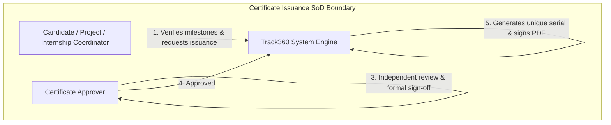

# User Roles and Permissions Specification
## Project: ExcelR Track360
### Student Lifecycle & Operations Management Platform
**Document Reference:** URP-TRK360-V1.0  
**Phase:** Phase 1 – Requirements & Business Analysis  
**Status:** Baseline Specification  

---

## 1. Role Architecture & Principles

ExcelR Track360 enforces an enterprise **Role-Based Access Control (RBAC)** architecture designed around the following architectural principles:

1. **Server-Side Enforcement:** Every API route, controller, and service layer operation verifies authenticated identity and required permissions on the server. Frontend UI adaptations (hidden navigation links, disabled buttons) are strictly cosmetic conveniences and are never relied upon for security boundaries.
2. **Principle of Least Privilege:** Users are granted only those privileges strictly necessary to perform their organizational functions.
3. **Separation of Duties (SoD):** High-stakes operational actions (such as credential issuance, grade overrides, and prerequisite waivers) require distinct roles for initiation vs. final approval.
4. **Data Isolation (Tenant/Entity Scoping):** Students are restricted to accessing their own profile, submissions, group allocations, and certificates. Administrative staff can query organization-wide data within their functional boundaries.
5. **Auditable Privilege Elevation:** All administrative overrides and status changes trigger immutable audit log entries recording the acting user, target entity, timestamp, previous state, new state, and mandatory justification.

---

## 2. Proposed Role Profiles

| Role Identifier | Role Name | Primary Responsibilities | Target Persona |
| :--- | :--- | :--- | :--- |
| **ROLE_SUPER_ADMIN** | **Super Administrator** | Global platform administration, user provisioning, role assignments, system-wide configuration, security policy definition, unconstrained audit inspection, and emergency disaster recovery overrides. | Platform Architect, IT Director, Head of Operations |
| **ROLE_OPS_ADMIN** | **Operations Administrator** | Daily operational supervision, batch creation, course setup, reviewer queue balancing, curriculum schedule management, and cross-module operational exception handling. | Operations Lead, Academic Operations Manager |
| **ROLE_CAN_COORD** | **Candidate Coordinator** | Candidate onboarding, profile maintenance, batch CSV bulk ingestion, contact information updates, lifecycle status updates (`Active`, `On Hold`, `Dropped`), and enrollment verification. | Admissions Coordinator, Student Success Lead |
| **ROLE_ASG_REVIEWER**| **Assignment Reviewer** | Evaluating student assignment submissions, grading against standardized rubrics, authoring constructive qualitative feedback, and issuing correction requests or passing approvals. | Academic Trainer, Technical Evaluator, Teaching Assistant |
| **ROLE_PRJ_COORD** | **Project Coordinator** | Managing the project repository, forming student groups, assigning project specifications, monitoring group collaboration, evaluating group project deliverables, and resolving group readiness blockers. | Project Manager, Technical Mentor |
| **ROLE_INT_COORD** | **Internship Coordinator** | Monitoring candidate progression toward internship criteria, logging formal internship start/end dates, tracking corporate or internal project milestones, and confirming completion. | Internship Manager, Industry Liaison Officer |
| **ROLE_CERT_APPROVER**| **Certificate Approver** | Independent verification of completed prerequisites, reviewing certificate generation requests, formal electronic approval/rejection of credentials, and authorized certificate revocation. | Academic Dean, Quality Assurance Lead, Managing Director |
| **ROLE_READ_ONLY** | **Reporting / Read-Only User** | Monitoring organizational health dashboards, viewing student lifecycle registries, inspecting SLA compliance, and generating scheduled analytics reports without write, edit, or approval capabilities. | Executive Leadership, External Auditor, Accreditation Inspector |
| **ROLE_STUDENT** | **Student / Candidate** | Accessing the student portal, viewing assigned curriculum, submitting individual assignment files, monitoring evaluation feedback, collaborating with assigned project group members, requesting project advancement, and downloading verified certificates. | Enrolled Learner, Intern |

---

## 3. Comprehensive Role-Permission Matrix

The following matrix delineates operational permissions across system domains.
**Legend:**
- **C:** Create / Upload / Initiate
- **R:** Read / View
- **U:** Update / Edit / Modify
- **D:** Delete / Soft-Delete
- **A:** Approve / Validate / Sign-Off
- **X:** Execute / Override / Reassign
- **E:** Export (CSV, Excel)
- **-:** Explicitly Denied (Access Blocked by Server)

| Domain | Entity / Operation | Super Admin | Ops Admin | Candidate Coord | Assignment Reviewer | Project Coord | Internship Coord | Certificate Approver | Read-Only Auditor | Student / Candidate |
| :--- | :--- | :---: | :---: | :---: | :---: | :---: | :---: | :---: | :---: | :---: |
| **Candidate** | View Full Candidate Profile (PII) | CRUDE | CRUDE | CRUDE | R | R | R | R | R | R (Own only) |
| | Masked Candidate Overview | R | R | R | R | R | R | R | R | R (Group peers) |
| | Create Single Candidate Profile | C | C | C | - | - | - | - | - | - |
| | Batch Import CSV Ingestion | C | C | C | - | - | - | - | - | - |
| | Update Candidate Contact Info | U | U | U | - | - | - | - | - | U (Limited own) |
| | Update Lifecycle Status (`Active`, `Drop`) | U | U | U | - | - | - | - | - | - |
| | Export Candidate Registry | E | E | E | - | - | - | - | E | - |
| **Assignment** | Create / Edit Assignment Templates | CRUD | CRUD | - | R | - | - | - | R | - |
| | Allocate Assignments to Batches/Students| C | C | C | - | - | - | - | R | - |
| | Upload Assignment Submission | - | - | - | - | - | - | - | - | C (Own only) |
| | Review, Grade & Provide Feedback | U | U | - | CRUD | - | - | - | R | - |
| | Request Corrections / Resubmission | U | U | - | U | - | - | - | R | - |
| | Final Passing Approval (`Approved`) | A | A | - | A | - | - | - | R | - |
| | Override Assignment Grade / Status | X | X | - | - | - | - | - | - | - |
| | View Submissions & Attempt History | R | R | R | R | R | R | R | R | R (Own only) |
| **Project** | Maintain Project Catalog / Specs | CRUD | CRUD | - | - | CRUD | - | - | R | - |
| | Form / Resize Project Groups | CRUD | CRUD | - | - | CRUD | - | - | R | - |
| | Allocate Project to Group / Student | C | C | - | - | C | - | - | R | - |
| | Upload Group Project Deliverables | - | - | - | - | - | - | - | - | C (Own Group) |
| | Review & Grade Group Deliverables | U | U | - | - | U | - | - | R | - |
| | Advance Group to Next Project | A | A | - | - | A | - | - | R | - |
| | Request Next Project Progression | - | - | - | - | - | - | - | - | C (Own only) |
| | Administrative Group Readiness Override | X | X | - | - | X | - | - | - | - |
| | Split Group / Remove Inactive Member | X | X | - | - | X | - | - | - | - |
| **Internship**| Initiate Internship Record | C | C | - | - | - | C | - | R | - |
| | Update Internship Calendar Dates | U | U | - | - | - | U | - | R | - |
| | Confirm Internship Milestone Completion | A | A | - | - | - | A | - | R | - |
| | Override Internship Eligibility Rules | X | X | - | - | - | - | - | - | - |
| **Certificate**| Verify Candidate Certificate Eligibility| R | R | - | - | - | R | R | R | R (Own only) |
| | Submit Certificate Issuance Request | C | C | C | - | C | C | - | - | - |
| | Formally Approve Certificate Issuance | A | - | - | - | - | - | A | - | - |
| | Generate / Re-generate Certificate PDF | X | X | - | - | - | - | X | - | - |
| | Download / View Issued Certificate PDF | R | R | R | R | R | R | R | R | R (Own only) |
| | Revoke Issued Certificate | X | - | - | - | - | - | X | - | - |
| | Public Certificate Verification | Public | Public | Public | Public | Public | Public | Public | Public | Public (Unauth) |
| **System** | Provision / Manage Staff Users & Roles | CRUD | - | - | - | - | - | - | - | - |
| | Modify System Config / Policy Settings | U | - | - | - | - | - | - | - | - |
| | View Full Audit Trail | R | R | - | - | - | - | - | R | - |
| | Export Operational Reports | E | E | E | - | E | E | E | E | - |

---

## 4. Separation of Duties (SoD) & Sensitive Approval Boundaries

To protect academic credibility and prevent fraud, Track360 implements strict boundary controls:

### Critical Boundaries
1. **Certificate Self-Approval Prohibition:** A Coordinator who initiates a certificate request cannot act as the sole approver for that certificate. Approval requires sign-off by a dedicated `Certificate Approver` or `Super Admin`.
2. **Reviewer Score Immutability:** Once an Assignment Reviewer marks an assignment as `Approved`, it enters a finalized state. Modifying an approved grade or reversing a rejection can only be performed by an `Operations Administrator` or `Super Administrator` with a mandatory reason code logged in the audit trail.
3. **Emergency Readiness Overrides:** A Project Coordinator may override a blocked group to advance active candidates, but the system logs the override, alerts the `Operations Administrator`, and preserves the record of who was bypassed.
4. **Student Scope Isolation:**
   - Students cannot view other students' assignment submissions, grades, or reviewer feedback.
   - Within a project group, students can see their teammates' display names and readiness status (`Requested Progression` vs `Pending`), but cannot modify peer data or submit individual overrides.

---

## 5. Session & Authentication Controls

1. **Session Lifetimes:**
   - Administrative Staff Sessions: Expire after 8 hours of inactivity or a maximum hard limit of 24 hours.
   - Student Sessions: Expire after 14 days of inactivity.
2. **Re-Authentication for Sensitive Operations:**
   - Certificate revocation, user role modifications, and global policy alterations require entering the current password or confirming an active multi-factor challenge.
3. **Account Lockout:**
   - 5 consecutive failed login attempts lock the account for 15 minutes to thwart brute-force password guessing.
