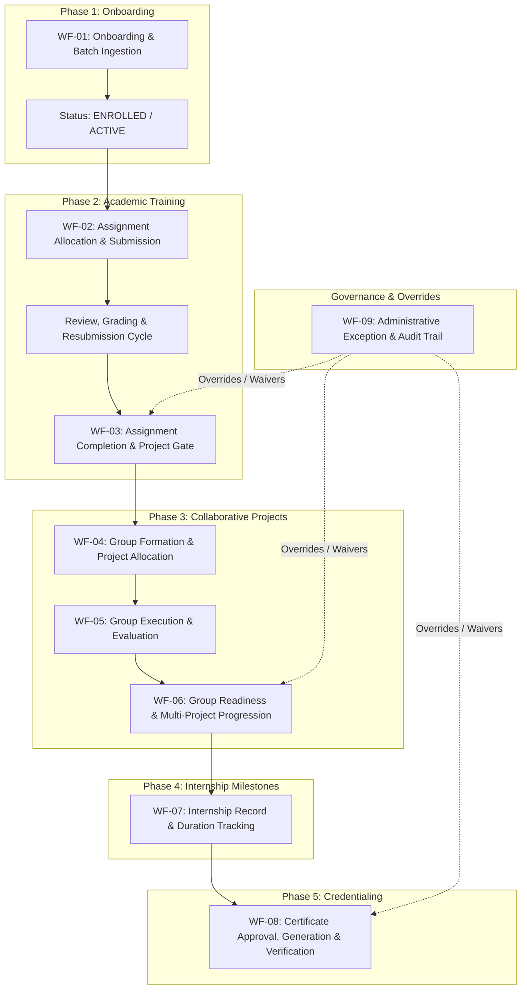
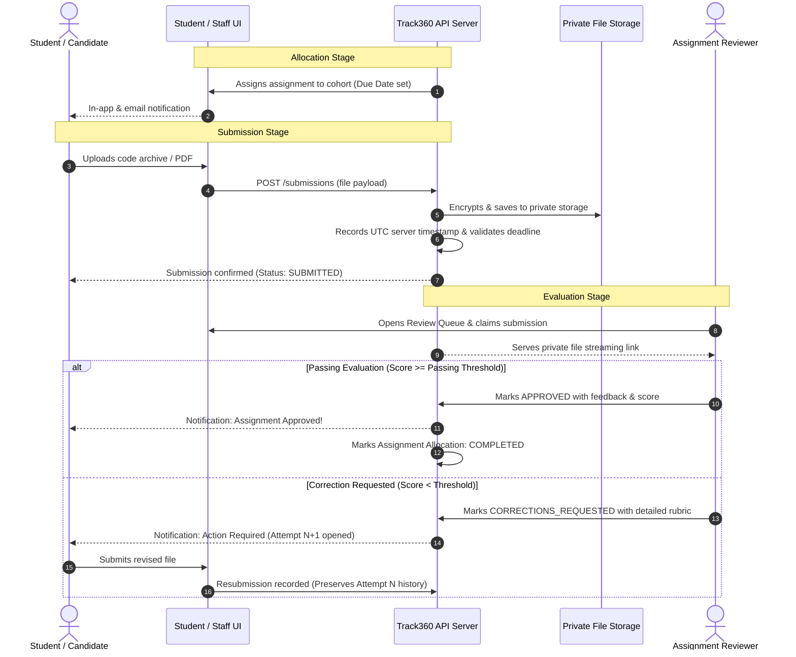
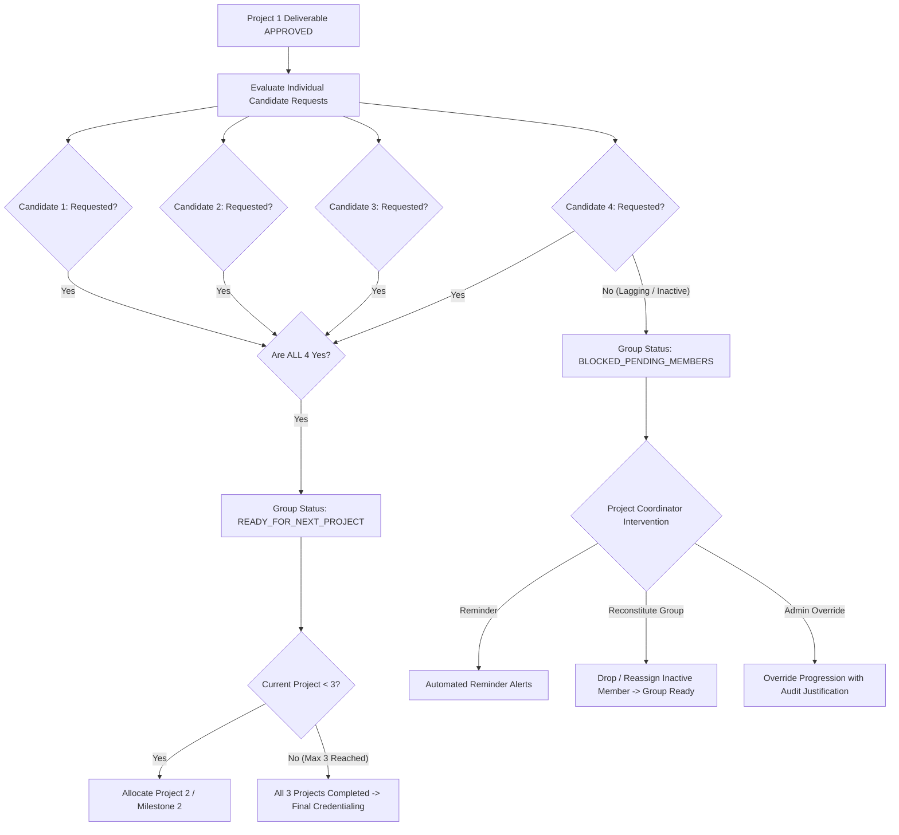
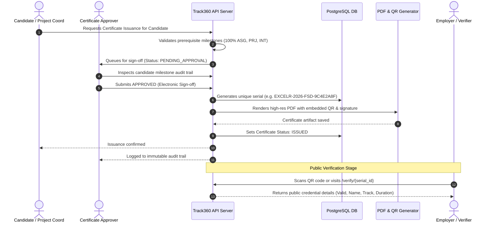

# Workflow Specification
## Project: ExcelR Track360
### Student Lifecycle & Operations Management Platform
**Document Reference:** WFS-TRK360-V1.0  
**Phase:** Phase 1 – Requirements & Business Analysis  
**Status:** Baseline Specification  

---

## 1. End-to-End Candidate Lifecycle Overview

The complete candidate journey through ExcelR Track360 spans six sequential operational phases, from initial cohort enrollment to certified career completion:

---

## 2. Detailed Lifecycle Workflows

### WF-01: Candidate Onboarding & Batch Ingestion

| Workflow Attribute | Detail |
| :--- | :--- |
| **Workflow ID** | WF-01 |
| **Primary Actors** | Candidate Coordinator, Operations Administrator |
| **Preconditions** | Batch and Course Track records have been established in the system. |
| **Trigger** | New student enrolls individually or a cohort CSV roster is uploaded. |

#### Step-by-Step Procedure:
1. **Initiation:** Coordinator navigates to *Candidate Management* and selects *Single Candidate* or *Batch CSV Import*.
2. **Data Ingestion:**
   - *Single Mode:* Coordinator enters full name, primary email, phone, course track, and batch.
   - *Batch Mode:* Coordinator uploads CSV roster. System triggers an automated **Dry-Run Validation Engine**.
3. **Validation & De-duplication Check:**
   - Server normalizes email (`lowercase`, `trimmed`) and phone number (`E.164`).
   - Checks against existing candidate records.
   - If duplicates or malformed rows exist in CSV, system presents an interactive error matrix displaying row numbers, invalid values, and specific error codes.
4. **Ingestion Confirmation:** Coordinator reviews dry-run summary (e.g., "48 valid rows, 0 errors") and clicks *Confirm Ingestion*.
5. **Entity Creation & State Transition:**
   - Database creates `Candidate` and `Enrollment` records within an atomic transaction.
   - Initial candidate state: `ACTIVE` (or `ENROLLED` if batch start date is in the future).
6. **Notification:** System queues automated welcome emails containing student portal login instructions.

---

### WF-02: Assignment Allocation, Submission, Review & Resubmission Cycle

#### Step-by-Step Procedure:
1. **Allocation:** Operations Admin or Candidate Coordinator allocates an assignment template to a batch with an established due date.
2. **Student Submission:**
   - Candidate views assignment guidelines and allowed file extensions (`.pdf`, `.zip`, `.ipynb`).
   - Candidate uploads deliverable before or after deadline.
   - Server generates an authoritative UTC timestamp. If submitted past deadline, sets `is_late = TRUE`.
   - Initial state: `SUBMITTED` (or `LATE_SUBMITTED`).
3. **Reviewer Evaluation:**
   - Assignment Reviewer claims submission from the pending queue (`Status: UNDER_REVIEW`).
   - Reviewer enters numerical rubric scores and qualitative feedback.
4. **Outcome Decision:**
   - **Path A (Pass):** Score $\ge$ Passing Threshold. Reviewer selects `APPROVED`. Assignment state transitions to `PASSED_COMPLETED`.
   - **Path B (Corrections Required):** Score $<$ Passing Threshold. Reviewer selects `CORRECTIONS_REQUESTED` with specific instructions. Candidate is notified.
5. **Resubmission:** Candidate uploads rework. A new `SubmissionAttempt` record (e.g., Attempt #2) is attached. Previous attempt data remains permanently visible to reviewers.

---

### WF-03: Assignment Completion & Project Eligibility Gating

| Workflow Attribute | Detail |
| :--- | :--- |
| **Workflow ID** | WF-03 |
| **Primary Actors** | System Engine, Operations Administrator |
| **Preconditions** | Candidate has active enrollment in a course track. |
| **Trigger** | Final mandatory assignment is marked `APPROVED`. |

#### Step-by-Step Procedure:
1. **Automated Audit Check:** Upon every assignment approval, the background engine queries all mandatory assignments assigned to the candidate's track.
2. **Evaluation:**
   - If $\text{Count}(\text{Approved Mandatory}) < \text{Count}(\text{Required Mandatory})$: Candidate remains in `ASSIGNMENTS_IN_PROGRESS`.
   - If $\text{Count}(\text{Approved Mandatory}) == \text{Count}(\text{Required Mandatory})$: Candidate automatically transitions to `PROJECT_ELIGIBLE`.
3. **Notification & Dispatch:**
   - Candidate receives an in-app badge: "Project 1 Eligibility Unlocked".
   - Candidate is queued into the Project Coordinator's *Eligible Candidates for Group Allocation* workbench.

---

### WF-04: Project Cataloging, Group Formation & Allocation

| Workflow Attribute | Detail |
| :--- | :--- |
| **Workflow ID** | WF-04 |
| **Primary Actors** | Project Coordinator |
| **Preconditions** | Candidates have achieved `PROJECT_ELIGIBLE` status. |
| **Trigger** | Scheduled project cohort kickoff. |

#### Step-by-Step Procedure:
1. **Group Builder Activation:** Project Coordinator accesses the *Group Builder Workspace*.
2. **Candidate Selection & Sizing:**
   - Coordinator views all unallocated `PROJECT_ELIGIBLE` candidates.
   - Sizing policy is set (e.g., 4 members per group). System enforces configured $\text{min} \le \text{size} \le \text{max}$.
   - Coordinator assigns 4 candidates to "Group-2026-Batch12-G04".
3. **Project Specification Assignment:** Coordinator selects "Project 1: Enterprise Microservices Platform" from the Project Library.
4. **Allocation Execution:**
   - System verifies that none of the 4 candidates have an existing active project.
   - Creates `ProjectGroup` and `ProjectAllocation` records.
   - Sets group project status to `IN_PROGRESS`.
5. **Student Portal Update:** Group workspace activates for all 4 candidates, displaying teammate details, project brief, milestones, and shared submission repository links.

---

### WF-05: Group Project Execution, Submission & Evaluation

| Workflow Attribute | Detail |
| :--- | :--- |
| **Workflow ID** | WF-05 |
| **Primary Actors** | Student (Group Representative), Project Coordinator |
| **Preconditions** | Group project status is `IN_PROGRESS`. |
| **Trigger** | Group completes project deliverables. |

#### Step-by-Step Procedure:
1. **Group Submission:** Any active group member uploads required deliverables (GitHub repository URL, deployed application URL, architectural documentation PDF).
2. **Submission Ingestion:** Server records UTC timestamp, links submission to all group members, and transitions group status to `SUBMITTED_FOR_REVIEW`.
3. **Evaluation:**
   - Project Coordinator reviews code quality, live deployment, and documentation against rubric.
   - Coordinator selects:
     - `APPROVED`: Deliverable meets industry standards.
     - `CORRECTIONS_REQUESTED`: Group must fix identified architectural defects.
4. **Approval Completion:** Once approved, the project milestone is marked `COMPLETED` for the current project tier (e.g., Project 1 Complete).

---

### WF-06: Group Readiness & Multi-Project Progression

#### Step-by-Step Procedure:
1. **Deliverable Approval:** Current group project deliverable is marked `APPROVED`.
2. **Individual Request Trigger:** In their student portals, each candidate is prompted to review feedback and click *Request Progression to Next Project*.
3. **Automated Readiness Audit:**
   - System evaluates: $\forall m \in \text{GroupMembers}, \text{RequestSubmitted}(m) == \text{TRUE}$.
   - If all members have requested: Group state transitions to `READY_FOR_NEXT_PROJECT`.
   - If any member has not requested: Group state is flagged as `BLOCKED_PENDING_MEMBERS`.
4. **Handling Blocked Groups:**
   - *Automated:* System sends automated email/in-app reminders to pending candidates at 24h, 48h, and 72h.
   - *Coordinator Action:* If candidate remains unresponsive after grace period:
     - Coordinator splits the group or moves the inactive candidate to `UNASSIGNED`.
     - System immediately re-evaluates group readiness with remaining active members.
5. **Progression Execution (Max 3 Projects Cap):**
   - If advancing from Project 1 $\rightarrow$ Project 2, system allocates Project 2.
   - If advancing from Project 2 $\rightarrow$ Project 3, system allocates Project 3.
   - If group completes Project 3: System prevents allocating a 4th project under standard policy. Group transitions to `PROJECT_TRACK_COMPLETED`.

---

### WF-07: Internship Record Creation & Milestone Tracking

| Workflow Attribute | Detail |
| :--- | :--- |
| **Workflow ID** | WF-07 |
| **Primary Actors** | Internship Coordinator, Operations Administrator |
| **Preconditions** | Candidate has completed at least one verified project milestone. |
| **Trigger** | Candidate reaches project milestone threshold. |

#### Step-by-Step Procedure:
1. **Eligibility Evaluation:** Candidate completes Project 1 $\rightarrow$ System marks candidate as `INTERNSHIP_ELIGIBLE`.
2. **Record Initialization:** Internship Coordinator initiates formal `InternshipRecord` specifying:
   - Candidate ID and Track
   - Formal Start Date (calendar date)
   - Anticipated End Date (calendar date)
   - Status: `ACTIVE_INTERNSHIP`
3. **Accredited Duration Calculation:**
   - Engine applies configured policy:
     - 1 Completed Project $\rightarrow$ 3 Months Accredited Duration
     - 2 Completed Projects $\rightarrow$ 6 Months Accredited Duration
     - 3 Completed Projects $\rightarrow$ 9 Months Accredited Duration
4. **Milestone Completion Verification:** When candidate completes required duration and internal review, Coordinator updates status to `COMPLETED_INTERNSHIP`.

---

### WF-08: Certificate Approval, Generation & Public Verification

#### Step-by-Step Procedure:
1. **Prerequisite Check:** System verifies candidate has 100% assignments passed, verified project milestones, and completed internship status.
2. **Issuance Request:** Coordinator submits an issuance request. Certificate enters queue as `PENDING_APPROVAL`.
3. **Approval Gate:** Certificate Approver reviews candidate record. Clicks `APPROVE` (or `REJECT` with reason).
4. **Artifact Generation:**
   - System generates cryptographically unique serial number: `EXCELR-[YEAR]-[TRACK]-[HEX8]`.
   - Generates QR code targeting `https://track360.excelr.com/verify/[SERIAL]`.
   - Renders official PDF merging student name, track, accredited duration, and date.
   - Saves PDF with non-guessable storage key.
   - Status transitions to `ISSUED`.
5. **Student Access:** Certificate becomes immediately viewable and downloadable in Student Portal.
6. **Public Verification:** Any third party visiting `/verify/[SERIAL]` views real-time authentic status without login.

---

### WF-09: Administrative Exception & Manual Override Workflow

| Workflow Attribute | Detail |
| :--- | :--- |
| **Workflow ID** | WF-09 |
| **Primary Actors** | Super Administrator, Operations Administrator |
| **Trigger** | Legitimate academic exception (e.g., student illness, custom syllabus, urgent project waiver). |

#### Step-by-Step Procedure:
1. **Action Request:** Administrator selects target entity (e.g., blocked candidate or stalled group).
2. **Override Selection:** Admin chooses override type: `PREREQUISITE_ASSIGNMENT_WAIVER`, `GROUP_READINESS_BYPASS`, `PROJECT_CAP_EXTENSION`, or `GRADE_REVERSAL`.
3. **Mandatory Documentation:** System prompts modal requiring:
   - Exception Reason Category (e.g., "Medical Extension", "Prior Industry Recognition", "Academic Board Waiver")
   - Detailed justification text ($\ge 20$ characters)
4. **Execution & Audit Log:**
   - Server validates caller's RBAC credentials.
   - Executes requested state transition.
   - Writes immutable entry to `AuditLog` table capturing actor, entity ID, previous state, new state, justification, timestamp, and IP.
5. **Notification:** Operations Administrator and Super Administrator receive notification of exception occurrence.

---

## 3. Entity State Transition Matrices

### 3.1 Candidate Lifecycle States
`ENROLLED` $\rightarrow$ `ACTIVE` $\rightleftharpoons$ `ON_HOLD` $\rightarrow$ `DROPPED` / `COMPLETED` $\rightarrow$ `ALUMNI`

### 3.2 Assignment Allocation & Submission States
`PENDING_SUBMISSION` $\rightarrow$ `SUBMITTED` / `LATE_SUBMITTED` $\rightarrow$ `UNDER_REVIEW` $\rightarrow$ `CORRECTIONS_REQUESTED` $\rightarrow$ `RESUBMITTED` $\rightarrow$ `APPROVED` (`COMPLETED`) or `REJECTED`

### 3.3 Project Group States
`FORMING` $\rightarrow$ `IN_PROGRESS` $\rightarrow$ `SUBMITTED_FOR_REVIEW` $\rightarrow$ `APPROVED` $\rightarrow$ `READY_FOR_NEXT_PROJECT` / `BLOCKED_PENDING_MEMBERS` $\rightarrow$ `COMPLETED`

### 3.4 Certificate States
`ELIGIBLE` $\rightarrow$ `PENDING_APPROVAL` $\rightarrow$ `APPROVED` $\rightarrow$ `ISSUED` $\rightarrow$ `REVOKED` (exceptional)
